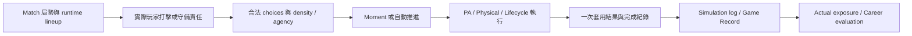

# 《棒球人生》Match Admission & Moment Eligibility Contract v0.1

專案：Baseball Life Simulation（棒球人生）  
日期：2026-10-15（Asia/Taipei）  
正式 Git 基線：`ab3117653945de0b7013636187c446276a96e634`  
任務：Read-only Architecture Audit / Contract Definition

**契約審查完成。推薦方案 A：分離 Synthetic / Canonical 驗收責任，交由人工裁決後另案施工。Ready for Phase B2＝NO；Ready for Commit／Sprint 10B＝NO。**

現有正式流程由 Playing Time 決定本場計畫，再由 roster／lineup owner 落實實際名單；career role 本身不構成先發資格。Moment 系統同時保留既有流程槽位與條件式機會，不能把固定 Moment1／3 當成所有合法完整比賽的普遍結果，也不能因這次替補缺少 Moment3 就宣告舊槽位契約過期。合法 SS 先發、seed88221 與原 #36 全部條件同時成立的證明仍 **UNVERIFIED**。

本輪新增 **1 次隔離 diagnostic child／1 場 Match**，重用 B1 正常第六局替補 fixture，未搜尋學校、seed 或能力。結果與 B1 的 fixture、initial Match、完整 Game Record、simulation log hashes 全部一致；原 #36 operands 仍為 false。正式 38 項 suite invocation＝0。**1460 個既有可讀檔案 hashes 全部不變，Production／正式 tests／既有 fixtures／seeds／pins delta＝0。**

## 1. Baseline／WIP Integrity

開工核對 branch=`main`，HEAD／main／origin/main tracking ref 均為指定基線，Git index 空。未 fetch，未重新核對遠端 server。B1 baseline 的 1414 個 hash、delivery 的 45 個 entries 與 delivery 檔案均核對，形成本輪 1460 個既有可讀檔案的 SHA-256 清單。前置 Triage、Repair A、B1、Test Reliability Audit、Entry-Safe 報告與重要 captures 都在此保護範圍；本輪未重跑 Repair A 40／90 checks 或改寫其 verdict。[Baseline](match-admission-moment-eligibility-contract-v0.1-baseline-evidence.json)、[前置報告與 exact source](match-admission-moment-eligibility-contract-v0.1-source-evidence.json)

B1 closeout 的 Git snapshot 取於其 closeout／delivery 檔案建立之前。新 audit utility 首次錯把這兩個已交付檔案當成 status 差異；核對 delivery hash 與 inventory 後，只修正新 utility 的 bookkeeping。沒有非預期既有檔案差異，當時 child executions＝0。另一次 launcher 在 spawn 前拒絕非 Sprint0.1 capture 前綴，改用既有 runner 接受的新獨立名稱；runner 本身未改。初次截短的互動 stderr 不作執行驗收證據。

12 個 protected paths 只核對 Git status、size／mtime，沒有讀、hash、執行或修改內容；metadata 一致不是內容 hash 證明。新 captures 使用獨立名稱與 exclusive-create，沒有覆寫舊證據。結案保存完整 Git WIP 與 hash 比較。[Closeout](match-admission-moment-eligibility-contract-v0.1-closeout-evidence.json)、[Delivery](match-admission-moment-eligibility-contract-v0.1-delivery-evidence.json)

## 2. Match Admission Authority Map

下表是 current source 的責任分工，不是另設一個 admission manager。[61 份 exact snippets／current source 比對](match-admission-moment-eligibility-contract-v0.1-source-evidence.json)、[雙向 traces](match-admission-moment-eligibility-contract-v0.1-architecture-coverage-evidence.json)

| 階段 | Authority owner／入口 | 決定的真實資料與邊界 |
|---|---|---|
| Player Capability／具體位置 | `player.js`：`settleHighSchoolEntryCapability`、`applyCanonicalPositionProfile`；PlayingTime 的 readiness snapshot | 能力 settlement 與具體守位意圖；不授予當場先發。`assertHighSchoolMatchCapabilityAdmission` 只驗能力，不等同驗完高中入學 |
| 正式入學 | invitation producer／selection → `completeHighSchoolEntry` | 驗 invitation set 與 finalized selection，建立 school assignment／roster context、由 owner 設 age16；缺資料回 false |
| Career Role | `script.js:4206`：`applyHighSchoolRoleState` | 寫 career role／context，不寫本場 lineup；role 是機會分數的一項輸入 |
| School／Team Need | HighSchoolEntryRosterContext 的 base roster／position competition；`getHighSchoolPlayingTimeSchoolContext` → readiness | 學校競爭深度、位置需求、projected role、教練風格與 position fit 供 PlayingTime 使用，不是 Match runtime 的最終名單 |
| 預計先發／替補／不上場 | `PlayingTimeGameExposure.resolveStartingOpportunity`，由 `createHighSchoolPlayingTimeOpportunity` 組輸入 | 產生 `plannedUsage`、assignedPosition、decisionId。一般 score≥55 start，<36 noAppearance，中間為替補類型；合法 direct-start history 為明確例外，位置不合法／pitcher deferred 仍 noAppearance |
| School-year roster | `materializeSelectedHighSchoolRoster` → `injectPlayerIntoSelectedRoster` → `TeamRosterFoundation.injectPlayerIntoRoster` | 依本場 starts 與 assignedPosition 請求 starter／bench。Injection owner 驗合法位置、替換 incumbent，建立 canonical players／starters／battingOrder；呼叫者不得自行安裝 finalized arrays |
| Match roster／初始九人 | `createHighSchoolMatchSimulationRoster` → `TeamRosterFoundation.toMatchRoster` | 由 canonical battingOrder 投影 runtime lineup／bench；`assertActiveDefense` 驗九人、身份唯一、九守位、位置合法、active actor 的 canonical membership |
| 本場初始 admission | `prepareHighSchoolYearOneMatch` | 消費 Opportunity、roster producer，設 lineup status／entry flags／slot／assignment；slot 由實際 lineup 查得。但 flags 與 membership 的交叉一致性沒有在此最後統一 assert |
| 正式替補時間 | `shouldEnterHighSchoolMatchPlayer` | noAppearance／deferred 不准進；需正確進攻側、entry inning、outs<3，當前打者必須是預定守位 incumbent，並滿足 coach context |
| 替補落實 | `enterHighSchoolMatchPlayer` → `insertPlayerIntoHighSchoolMatchLineup` | incoming 必須在 bench；換下同一 incumbent，先驗 next active defense，再更新 runtime lineup／bench／slot；隨後同步 substitute／entryCompleted／fielding assignment／currentBatter，記 playerEntry |
| 守備實際參與者 | `DefensiveOpportunityFoundation.resolveDefensiveOpportunity` → `getHighSchoolPhysicalDefensePlayerContext` | 用 physical truth 對當前 runtime active roster 重新綁 primary／secondary defender。SS metadata 不會取代正式 physical owner 的 actor binding |

**預期與實際的界線：** `highSchoolRoleCode`、`match.role`、Opportunity plan 是角色或計畫；runtime `rosters[side].lineup`、當前打者、實際 defender、playerEntry event 才是當場參與證據。`isHighSchoolMatchPlayerActive` 自身只讀 `playerEntryCompleted` 與 starter／substitute status，不能單獨當 roster membership validator。School-year 的初始 battingOrder 不需被替補 owner 重寫；當場 batting order 由 runtime lineup 維持，不能將 final lineup 有 player 誤稱開賽先發。

正常 fixture 的正式 producer 沒有產生三個 B1 矛盾狀態；已執行的矛盾案例都是 negative clone mutation。這不是所有 career／save／browser 路徑均不可能產生矛盾的證明。

## 3. Moment Eligibility Authority Map

### 3.1 Moment1／Moment3 的真正條件

`highSchoolYearOneMomentIds` 是三個固定既有槽位；**數字 3 不代表玩家第三個打席，也不是全域事件唯一鍵**。`getHighSchoolYearOneMomentId` 另保留動態 offense／defense IDs。[script.js](../script.js) 的實際函式原文及行號均存於 source evidence。

| Identity | 正式 playback 的 admission／producer | 保證與限制 |
|---|---|---|
| `hs_y1_match_moment_1` | `full_match_flow` 的 target=`firstOffense`；momentIndex0／currentMomentId1，玩家 active、正確進攻側，當前 runtime lineup batter=`player` → first offensive producer | 是入場後的首個既有關鍵打席槽位，不限第幾局。沒實際輪到玩家不會由這個 gate 產生；先發標籤不能讓 NPC 打席變成玩家打席 |
| `hs_y1_match_moment_3` | target=`finalOffense`（通常由 `moment_2_resolved` 而來）；玩家 active、正確進攻側、batter=`player`，inning≥`max(5, entryWindow+1)` → final offensive producer／`legacyFinal:true` | 固定流程槽位加條件式實際打席。替補、early ending、打序與前段 phase 都會影響能否到達；不能推出「先發必定有兩個進攻 Moment」 |
| `hs_y1_match_offense_N` | 實際 player PA，offensive classification 有策略取捨且 density.allowed；或 late-game agency 選 manual 後走 classified route | N 是 log 中已完成 player PA 數＋1，不是 Match 全部打席序號。一般 classified 路徑不自動換成 Moment3 |
| 固定 Moment2／`hs_y1_match_defense_N` | 首個既有 defense 階段的 meaningful decision 可用固定2；其後依已建立 defensive meaningful count 命名 | SS 只是可能責任之一；routine／ordinary／density suppressed 不應被算成已完成 defense Moment |

`advanceHighSchoolMatchPlaybackStep` 的 target 隨 phase 決定：full_match_flow→firstOffense，moment_1_resolved→defense，moment_2_resolved→finalOffense，其餘→finish。Routine 防守也可能經 pending resume 推進至 moment_2_resolved；**不要求一定先完成一個防守 Moment 才能到 finalOffense**，但仍需實際有相應防守流程與後續玩家打席。不能把 Moment3 簡化成「第二次上場打擊」。

終盤 agency 是另一條真實入口：已入場、正確 player PA、live game、inning≥regulationInnings 且該 PA 未 resolve，才提供 manual／simulate。simulate 可以合法不建立玩家 offensive Moment；manual 按 first／final／classified 路由。這進一步說明固定槽位不等於每場數量配額。

### 3.2 合法選擇、SS 與防守 density

進攻 classified 路徑的 `classifyHighSchoolOffensiveOpportunity` 區分 routine／meaningful／highLeverage／critical，檢查 live context、不同 approach commitments 與不同 objectives；density 可壓抑重複結構。沒有策略取捨時，一般 classified 路徑回到正常 PA 模擬。

但 current first／legacy-final producers 有 `forceScripted:true`，並直接以 created=true 記 density、建立 ready Moment；它們**沒有在函式內以 density.allowed 或 choices 非空作最後拒絕**。因此「所有 offensive producers 都完全由自然 leverage 決定」不成立。這是現有固定槽位相容責任；是否允許固定首／末關鍵打席須由 Moment owner 裁決。正常 fixture 有合法 zone 等 choices，沒有重現零合法 choices 的自然 deadlock；該情況的可達性仍 UNVERIFIED，不能直接定為已發生 Production bug。

防守 outer gate 先查 active、對手進攻、outs<3，再看 force／比分壓力、entry 後 fallback inning 與該半局 routine 是否已呈現；實際 1B receiver 有專用參與路徑。正式 physical pipeline 再以當前 roster 進行 responsibility binding、reach／secure／throw／route viability。玩家站 SS 並不保證球真的落入其責任、可及範圍或形成至少兩個不同有價值的決策。

`classifyHighSchoolMatchDefensiveOpportunity` 經 position family classifier 與 density，只有 meaningful 且 allowed 才保留 playerMeaningfulDecision；否則可降為 routine。Lifecycle admission 也要求 supported、playerOwnsDecision、至少兩個 route identities 才能呈現；automatic／AI／unsupported modes 各自處理。這些 owner 已存在，不能只看到 metadata gap 就再造第二套 eligibility engine。

`defensiveMeaningfulDecisionCount` 在**建立決策時**增加，不是在完成時增加；completedMoments 在結果套用時 append。因此比賽中 pending decision 可能短暫 count 不等，終局 equality 才是原 #36 要守住的責任。零＝零可成立但沒有任何守備 coverage；本輪就是這個情況。

### 3.3 執行、完成、Record 與 Career

公開 `resolveHighSchoolYearOneMatch` 查 current identity、phase、合法 choice、已完成 ID；PA resolver 另以 resultApplied 擋重複結果。Ground settlement 有 runnerSettlementIdentity／handoff settlementApplied 與 lifecycle transitions；GameRecord 有 eventId dedup、defensive play identity 的 attribution dedup 與 final lock。正常本場重複 resolve／settle 的 no-op 已實測。

**Exactly once 的承諾有 owner 範圍。** `recordHighSchoolYearOneMoment` 本身直接 append 並加 contribution，沒有獨立 dedup；`recordHighSchoolMatchSimulationEvent` 也不是同一語義事件任意重呼皆冪等的 API。用新 sequence 重送同一語義結果不能期待 GameRecord 自動辨識。不能將公開流程的 no-op 擴張為所有低階 helper 的任意呼叫保證。

GameRecord 保存 inning lines、球隊 R/H/E、player batting／fielding／pitching／位置紀錄、result 與 eventRefs，透過 real PA／run／defense 等 events 更新。它**沒有 completedMoments 全文陣列**；完整決策、pitch history 與敘事保留在 Match completedMoments／simulationLog，save normalization 保留這些資料與 normalized GameRecord。若 UI 要每個 Moment 的原始決策局勢，不可只讀 GameRecord eventRefs。

本輪另核對到既有 snapshot 語義：`settleHighSchoolYearOneMatch` 把最後一個 completedMoment 的 scores／runners／outs／half 改成終局。正常 case 的 resolved event 是第六局下2 outs，final completedMoment 成為 inning6／half終／outs3／終場比分；原事件仍在 log，GameRecord 也正確。這不是本輪新造成的 record 損壞，但「completedMoment 代表決策當下 snapshot 或終場摘要」需要人工確認，不能假設兩者完全相同。

結算鏈為 GameRecord finalize → actual exposure finalize → MatchExperienceDevelopment → competition evidence／role reassessment／next Opportunity／history。正常本場 actual PA1、defensiveInnings1、evaluation sampleCount1、match identity 一次寫入、experience settled=true。`deriveHighSchoolMatchActualExposure` 的 started 仍信任 lineupStatus，不重新證明初始 membership；這是 starter metadata gap 可能向 career 傳遞的源碼風險。Evaluation 的 appliedMatchIdentities 保留最近12筆，不宣稱有跨任意久遠 replay 的永久全域 ledger。

## 4. Contract Matrix

狀態只描述下列具體 invariant。CURRENTLY ENFORCED 表示所列 owner／已核對入口有該機制；不等於 browser、所有合法 careers 與所有 adversarial 呼叫均已驗收。

| 項目 | Authority Owner | Input | Invariant／目前狀態 | Failure Behavior |
|---|---|---|---|---|
| Capability admission | Player validation／script assertion | capabilityState、player | 正式 Match 拒絕未 settlement 能力：**CURRENTLY ENFORCED** | validation 不合法則 throw；不代替 invitation validation |
| Career Role | applyHighSchoolRoleState | role code、evidence | 角色不直接授予本場先發：正式 owner 完整時 **CURRENTLY ENFORCED** | 非法 role 正規化 bench；缺 PlayingTime 時有 legacy fallback，見下列 gap |
| Playing Time | PlayingTimeGameExposure | readiness、school/team need、role、context、identity | owner 決定 start／sub／noAppearance：**CURRENTLY ENFORCED** | readiness version 錯 throw；位置不合法／pitcher deferred→noAppearance；direct-start 是明確 input 例外 |
| 必要 owner 存在 | script prepare／current index | runtime globals、manifest | 缺 PlayingTime 時禁止以 role 代替決策：**NOT ENFORCED** | createOpportunity 回 null，prepare 可按 role fallback；current browser index 有載入 owner |
| Starting Lineup 結構 | TeamRosterFoundation | canonical roster、battingOrder→runtime lineup | 九人、身份唯一、九合法守位、active actor canonical membership：**CURRENTLY ENFORCED** | toMatchRoster／assertActiveDefense throw；validateRoster 回 errors |
| Starting admission 一致性 | prepare／runtime state integrity | plan、flags、player slot、lineup | starter flags 必須等價於實際 player starting membership：**PARTIALLY ENFORCED** | slot 有由 lineup 求值，但 B1 flags-only 矛盾仍通過 native integrity |
| Bench back-reference | TeamRosterFoundation／substitution | teamRoster.players、bench | bench player 必須在 canonical players：**PARTIALLY ENFORCED** | 初始 bench-only 缺 member 未拒絕；換入成 active 時 next active validation 會檢查 membership，不能說完全無防護 |
| Substitution | shouldEnter／insert／enter | plan、時間、incumbent、bench | 合法時間與 actor；runtime 打序／守位同步：**CURRENTLY ENFORCED**（核對入口） | 未到時間／不是 incumbent 回 false；缺 incumbent／bench actor／非法 next defense throw |
| Assignment metadata 一致性 | Match metadata／actual roster binding | playerFieldingAssignment、runtime defender | metadata 必須與 actual SS 相符：**PARTIALLY ENFORCED** | global integrity 未拒絕；正式 physical owner 另驗真實 actor binding |
| Offensive Moment 實際打擊 | playback／first-final gates／agency | active、side、lineup batter、state | 合法實際 player PA 才呈現玩家進攻：**PARTIALLY ENFORCED** | 正常 gates 核對 actual batter；低階 producers／legality helper 不自行重驗完整 admission |
| Offensive 決策必要性 | classification／density／first-final producer | legal choices、gameLive、leverage | 所有 Moment 均需合法策略取捨：**PARTIALLY ENFORCED** | classified 不允許時 routine PA；first／legacy-final 有 forceScripted 且直接建立 ready Moment；零 choices 自然可達性 **UNVERIFIED** |
| Defensive Moment | physical binding／position family／density／lifecycle | actual defender、physical truth、routes、responsibility | 合法參與＋meaningful gate 才攔停：**PARTIALLY ENFORCED**（全鏈） | 正式 detailed owner 有 binding／lifecycle guards；outer active helper 仍信 flags，舊缺-owner synthetic compatibility 不等價 |
| Defense completion count | density producer＋resolution | created decision、completed event | 終局 completed defense＝created meaningful defense：**PARTIALLY ENFORCED** | 分處 producer／consumer，沒有統一終局 equality assert；本場0＝0通過，非零自然SS case **UNVERIFIED** |
| Moment Completion | public resolve／PA／Ground Lifecycle | phase、identity、legal route、resultApplied | 同一公開 decision 的結果只生效一次：**CURRENTLY ENFORCED**（本場與已核對 guards） | duplicate公開resolve回false；低階 append 不獨立 dedup，任意呼叫 **NOT ENFORCED** |
| Game Record | MatchGameRecord | 真實 simulation events、rosters、eventId | 相同 eventId 一次計數、final lock、內部 totals consistency：**CURRENTLY ENFORCED** | duplicate／locked 回狀態；integrity 不符 throw；不代替外部 roster admission 證明 |
| Match／Record 對照 | simulation event bridge＋final assertions | Match score／log、Record totals／refs | record 與實際本場一致：**PARTIALLY ENFORCED** | Record 自檢不能獨立驗回所有 Match state；本場 totals／119 refs parity已確認 |
| Settlement／Career | settleMatch、experience、reassessment | completed match、actual exposure、identity | 本場結果、紀錄與 career effects 不重複：**CURRENTLY ENFORCED**（同一本場） | settled／completed no-op；experience settled guard；evaluation recent identity duplicate；exposure仍依賴前段flags一致 |
| Save retention | normalizeSave／normalizeGameRecord | saved Match、completedMoments、log、record | 本場必要決策與 Record 保存：**CURRENTLY ENFORCED**（本場memory round-trip） | record schema／integrity錯會throw；不宣稱所有非法 metadata 已 reconcile；實際 browser storage reload **UNVERIFIED** |

## 5. Current vs Desired Behavior

| 設計要求 | Current source／可信觀測 | 契約裁決需要 |
|---|---|---|
| 教練機會決定先發，career role不是先發 | 完整 owner 的正常 fixture：role starter、score44，實際 bench→第六局 substitute | 保留此責任；missing-owner fallback 的支援範圍另定，不用 role 造 canonical PASS |
| 沒參與就不產生玩家 Moment，AI完整推進 | 本輪正常入學到entry前無Moment；B1 debug noAppearance全場亦0，但該case未完成正式入學 | 合法 noAppearance 全場仍需事前固定fixture驗證，不將age10 case升格 |
| 不強迫固定數量 | 有一般 density／agency／AI PA，也有 first／legacy-final 強制槽位路徑 | 釐清固定槽位的局部相容責任，不將兩槽位硬套所有 career matches |
| 沒合法決策就自動推進 | classified與lifecycle有此機制；first/final producer末端未統一檢查 | 先確認實際可達性與slot設計，再決定是否需要修改現有 owner |
| 參與／紀錄／career一致 | 正常本場record、save、evaluation／experience一致，重複公開呼叫不生效 | Cross-owner flags／bench／assignment 仍有接受矛盾的邊界，尚未證明正常producer觸發 |
| 決策局勢可追溯 | log保留原事件；最後completedMoment被終局摘要覆寫部分欄位 | 決定摘要欄位與原始decision snapshot的責任；本輪不修改schema或guard |

## 6. Isolated Probes 與執行證據

只重用 B1 `normal-entry-proof.cjs` 的 exact entry program：原能力、具體SS、default invitation index0、正式選校與 completeEntry、career role starter、pending simulationSeed88221。由 prepare 建 roster／plan，原 secure／zone／first-legal policy、sample0.72、safety1400。未手改任何當場 roster／lineup／Moment ID／局勢，沒有新的 fake actor／Moment／out。[Driver source](match-admission-moment-eligibility-contract-v0.1-probe.cjs)

既有 Entry-Safe runner／preload 未改，以 standalone main 執行；actual command、Node、entry witness、source before／after hashes、完整 stdout／stderr、exit／elapsed 都保存在 [新 raw capture](test-infrastructure-sprint-0.1-admission-moment-contract-v0.1-probe-evidence.json) 與 [assertion witness](test-infrastructure-sprint-0.1-admission-moment-contract-v0.1-probe-evidence-assertions.json)。政策120000ms／16000000-byte stdout buffer，implicit Git show相容30000000 bytes；實際308.6385ms，exit0，stderr空，entryVerified／sourceStable=true，30個成功Node assertion calls。這是 **1個diagnostic PASS**，不是30項正式suite驗收或原 #36 PASS。

| 探針／來源 | 實際結果 | 限制 |
|---|---|---|
| 正常fixture上場前逐tick觀測 | role starter但entry=false、lineup無player；completedMoments始終0 | 是正常替補case的入場前區段，不是另一個合法noAppearance全場 |
| 同次正式替補 | sequence85、第六局下1 out、第8棒，換下真正SS incumbent；sequence86才建立Moment1 | 非先發證明 |
| 玩家合法決策 | 1次zone；當下actual batter與currentBatter均player，SS actual defender為player | 無自然玩家守備meaningful Moment，不能聲稱守備各分支已跑過 |
| 重複相同resolve | 第一個Moment完成後立即重呼相同decision／expected ID，回false，完整player／Match hash不變 | 公開入口的該決策，不擴張至任意低階append |
| 重複settle／finish | settle兩次＋finish一次均false，player／Match完全不變，gameEnd一次 | 同一本場completion邊界 |
| Record identity | 用同一真實player PA event，另建隔離record，第一次applied、第二次duplicate，record不變；final record重送回locked | 隔離record不用來替代本場authority；沒有注入新事件 |
| 完整record與replay | 119 log events／119 unique record refs；final score home1／away6、PA1、integrity=true；與B1 record／log hash相同 | record dedup依identity，不宣稱同語義換sequence也會被拒絕 |
| Save round-trip | `normalizeSave`記憶體round-trip後record與completedMoments逐物件相等，原player未變 | 未操作browser／local disk save lifecycle |
| B1 noAppearance／三個cross-owner gaps／missing-owner | 只重讀並hash核對既有raw與source，沿用原判定 | 本輪沒有再mutation正式Match或重跑negative suites |

完整 observations、actual exposure、evaluation／experience 與 lineage 見 [Findings](match-admission-moment-eligibility-contract-v0.1-findings-evidence.json)。正常fixture、initial Match、完整Record、log四項 parity均true。Record hash=`abb6ee6487c8f39a3e3de3afe945f2494a374d9b78d6c6a6a358c9808dd6cf92`。

同場原 #36 operands：completed=true，Moment1=true，Moment3=false，defense completed0／created0、equality=true，safety110<1400；combined=false。原assertion沒有刪除、修改或改列PASS。

## 7. Match #36／#37／#38 Responsibility Review

原正式test完整source及原assertions保存在 source evidence；本輪沒有執行它，也沒有修改它。[原正式檔](../tests/baseball-match-foundation-2-2-2-test.js)

| 測試 | 原責任與驗證價值 | 現有問題／實際狀態 | 新契約候選、原保護如何保存 |
|---|---|---|---|
| #36（line153） | seed88221完整終局、固定Moment1及3、defense完成數＝meaningful建立數、safety<1400；同時保護既有兩個offense槽位與有條件defense | `__finish2222`重用synthetic `__setup2222`，未合法入學、手寫starter／entry與局勢、留下away打序offset2、原33-module VM走legacy；Triage原suite35項後#36 FAIL。B1與本輪合法替補combined仍false | 將「合法full-match closure」與「既有slot producer」分開列責任；原fixed IDs及equality／safety價值需逐項保留、另證或經人工明確批准轉移，不能只改成completed就宣稱等價 |
| #37（line154） | seed88222同決策policy的full-match終局與state integrity；第二個固定seed的不同局勢保護 | 用同一`__finish2222`；顯式return只查completed＋final integrity，沒有每tick直接呼叫checker；部分runtime owner自行assert。原suite先在#36停止，#37未到；B1與本輪均未執行88222，仍UNVERIFIED | 保留88222與policy，合法context下驗終局及每次狀態轉移integrity；不能用88221結果替代，也不能只把標題當全程逐tick證據 |
| #38（line155） | routine commentary不露hardGrounder／straightAtPlayer／playerRoutinePlay／selfCoverFirst／decisionTension等raw identifiers | 自行呼叫`__candidate2222()`→新的`__setup2222()`，資料不取自#36 full-match結果；共用VM／synthetic helper。原suite因#36先throw而未到，本輪未重跑，不改列PASS | 留在synthetic presentation責任；不需為驗canonical full-match而搬動或重寫。執行順序阻擋與fixture資料依賴需分開記錄 |

**#36確實混合兩種責任。** 目前 source 明確仍有固定first／final producers，所以不能宣布fixed Moment3全面過期；同時正常替補僅有一個合法PA，不能要求比賽補出不存在的第二個玩家PA。

若人工確認「兩個固定槽位」是必須保留的特定情境，應事前固定合法career、entry、Opportunity、初始lineup／SS、seed與決策，先驗admission，再由真實playback到達兩個slot，逐一證明trigger與完成事件。若原seed88221的合法先發無法成立，就維持FAIL／UNVERIFIED或另案裁決seed authority，不找seed／學校直到PASS、不用synthetic狀態冒充canonical proof。

若人工確認Moment3只是條件式自然事件，canonical驗收候選應查：每次玩家決策均有真實參與與合法選擇、distinct event identities、每個已admit的決策恰好完成一次、routine／不上場不虛構Moment、完整終局與Record／career一致；固定ID局部producer測試仍保留。**這是待批准候選，不是本輪變更原 #36 的理由。**

## 8. Illegal State Risk Classification

P0為可能造成非法上場／重複結算／record損壞且已有可採信觸發路徑的最高優先調查；P1為確定契約矛盾但正式producer觸發未證明；P2為目前只在舊fixture／環境出現。**本輪沒有證實自然Production P0重現**，也沒有將所有gap自動升格為需要Production guard。

| 狀態／分類 | 是否由正式producer自然產生 | 比賽／Moment影響 | Record／Save／Career影響與現有owner | 最小後續責任 |
|---|---|---|---|---|
| starter flags但無player lineup：**P1** | B1人工clone才重現；本輪正常producer無此狀態；全career未窮舉 | offensive gate有actual batter保護；active helper／defense outer gate信flags，可能錯誤candidate，不能直接宣稱已產生非法Moment | actual exposure的started信status，可能錯記參與或career；Record自檢不是admission檢核；save可保留metadata | 優先審查prepare最後的plan／actual slot一致性與restore入口。現有Match owner可承擔，只有證實save來源時才擴到Save；不新增manager |
| bench player不存在teamRoster.players：**P1** | 只在人工刪canonical member的clone；正常injection會建立member | 初始bench引用矛盾未拒絕；**active lineup membership已有檢查，insert驗next active會阻擋這種缺member actor** | 未證明已污染本場Record；不一致bench可能被save保留 | 如需修復，優先由TeamRosterFoundation定義bench reference完整性；normal producer來源未證明，先補有限契約驗證 |
| playerFieldingAssignment聲稱SS但actual SS是NPC：**P1** | B1 metadata mutation；正常owner同步成功 | global integrity漏查；physical responsibility仍按actual roster綁actor，不等於改metadata就一定拿到SS決策 | Record bridge會用assignment作playerPosition context，若矛盾狀態被消費可能誤標位置；Save／career也依賴metadata；本輪無污染重現 | Match assignment同步／驗證責任，加上既有physical binding即可；是否需roster owner API調整待證據，不跨Physical重做判定 |
| currentBatter與battingOrder不符：**已有拒絕機制** | 人工clone | native current-batter-mismatch，assert throws | 在消費錯打者前有integrity boundary；不是新增guard需求 | 保留native negative與正確producer同步 |
| 缺PlayingTime後role fallback：**P2（當前證據）** | 人工漏載module才重現；current index有owner | 能建fallback starter，破壞「機會決定」的canonical測試前提；不等於browser正常載入會漏module | 若當canonical使用可能形成錯誤exposure來源；未執行該case取得#36PASS | 先修／驗formal test manifest與必需globals；只有正式支持缺owner runtime時才升P1討論fail-closed策略 |
| 原非法debug入學／synthetic full-match fixture：**P2** | 原test手寫chapter／entry／state | 不足以驗canonical完整比賽；legacy重複deepGrounder問題保留原Triage判定 | 不得用其record代表正常career correctness | 分離test責任／合法fixture proof，不改能力或Production機率 |
| 低階Moment append沒有dedup：**P1 API範圍風險** | 未證明公開正常流程繞過guards；本輪公開duplicate正確no-op | 任意直接重呼helper可增加contribution／Moments；不宣稱公開resolve可重複生效 | 新sequence不能被Record當同eventId拒絕；career會讀contribution | 先界定helper為內部單次consumer；若出現真實重入再由既有resolution owner修，不在每層撒guard |
| 最後completedMoment終局覆寫：**P1語義待裁決** | 正式settlement自然發生，本輪已觀測 | 不改真實已執行play，但Moment snapshot與原resolved event不同 | log／Record正確、Save原樣保留；若讀者假設snapshot不可變會誤解 | Moment／presentation／save consumer先裁決欄位語義，未批准schema或Production patch |

三個B1跨owner gaps的native結果、mutations與本輪沿用hash見 findings。沒有以diagnostic boundary checker代替Production guard，也沒有把negative clone解讀成UI自然producer重現。

## 9. Synthetic／Canonical 修復方案比較

| 面向 | 方案 A：分離驗收責任（推薦） | 方案 B：維持原結構、修正full-match fixture |
|---|---|---|
| 修改範圍 | 既有synthetic局部checks保留；另建小型canonical context/helper與full-match gates；明列#36責任轉移對照 | 同檔只為#36／#37切換formal context/helper；#1–35／#38原synthetic context與assertions保留 |
| 原保護 | 固定slot／routine／presentation與full-match／integrity各有明確證據；原#36combined尚未等價前保留未解決狀態 | 能找到合法先發且固定1／3均成立時，原combined assertion可原文沿用；目前尚無此fixture proof |
| Moment ID契約 | 應批准「局部固定槽位」與「canonical條件式事件」各自驗收；不能直接刪舊ID要求 | 若堅持原兩ID，必須先證明可達。若改ID條件，同樣需要人工契約批准，不能以fixture修復名義弱化 |
| Seed authority | 88221／88222固定simulationSeed，另記Opportunity identity；先解決supplied分支的authority限制 | 同一限制；不能用Opportunity-derived不同seed冒名原seed |
| Production相容性 | 重用entry／PlayingTime／roster／lifecycle／record owners，fixture helper只組輸入與讀證據 | 同樣能重用，但原檔同時含synthetic與formal兩種環境，容易誤用helper |
| UI／SS Vertical Slice重用 | canonical helper與參與／identity／record assertions可獨立重用 | 可以抽出共享helper，但單檔global context與既有槽位耦合較高 |
| 執行／維護成本 | 增少量固定full games與一次formal VM載入；責任清楚、failure較易定位；需維護責任對照，尚未benchmark | 改動檔案較少、仍跑兩個full seeds；要維護雙context隔離，且#36fail會阻斷#37／#38的原執行次序 |

推薦A，因現有證據已證明合法替補與固定兩槽位不是相同前提。A仍須把原#36每個保護點映射到等價證據，不能只另加一個易過的completed check。若人工要求原#36原文完全不變，則採B並先完成合法先發／seed／slot可達性proof；無法證明時保留FAIL，不以調能力、NPC、seed或fake事件解決。

## 10. 最小修改與驗收建議（未施工）

1. **先裁決責任。** Match／Moment owner確認fixed first-final slot與canonical自然機會的關係；對#36五個operands逐項接受責任映射，確認最後Moment snapshot語義。這些是人工批准前提，本報告不是批准。
2. **先解seed與admission proof。** 88221／88222指simulationSeed。`prepare`無supplied Opportunity可消費pending seed；有supplied時由decisionId／matchId另算seed。B1獨立debug start-plan探針算出3144261226，並非16歲正常先發全場。不得以preserveDecisionId、換hash identity、fake direct-start flag繞過；必要的Match owner seed契約調整需獨立授權。
3. **最小test scope。** 僅原#36／#37的full-match context及必要專用helper／獨立canonical suite候選；formal current-index manifest、browser globals模式，application-controller維持測試VM既有排除。保留#1–35／#38、原能力、NPC強度政策、0.72、1400與原assertions；原Moment ID要求未批准轉移前仍是gate。
4. **Admission先驗。** 完整entry合法、Opportunity plan、canonical membership、初始lineup、actual SS、slot／status一致；替補另驗playerEntry先於玩家決策，noAppearance另有事前固定合法case。取得計畫或獨立starter roster API回傳值都不足以取代同一次Match證明。
5. **原價值逐項驗收。** 两固定seed均完整執行；每步state integrity；合法player choices與physical participation；每個created decision一次完成；終局defense equality另有非零合法守備fixture；Record totals／event refs／save round-trip／career一致；公開duplicate calls不重複生效。若要保留固定Moment3，另驗其合法可達trigger，不改成「有任何offense就算」。
6. **有證據再修guard。** 三個cross-owner gaps先限定producer／restore邊界與來源；已有active defense／physical binding／PA／lifecycle／record guards優先重用。只有實際來源證明需要時才給單一owner最小patch，跨Save／roster等修改另明列批准，不預設大規模防禦程式碼。

後續正式驗收須讓原38項實際完整到達並分開報#36、#37、#38結果；不能用本輪diagnostic PASS或Repair A歷史90/90補成正式38/38。本輪沒有建立任何正式patch。

## 11. 尚未解決的契約缺口與證據限制

- 原能力、固定88221／88222、合法SS先發、原決策與固定Moment1／3同時成立：UNVERIFIED；未找seed、未選學校直到PASS，未推論所有合法career皆不可能。
- #37的88222與原#38實際執行仍UNVERIFIED；本輪沒有重跑原suite。
- 合法正式入學的noAppearance全場、自然非零SS守備與所有Physical／Reach／Throw／Lifecycle分支未新增runtime驗收。B1 age10 noAppearance及Repair A bounded證據的限制保持。
- 完整owner的正常producer未觀察到三種metadata矛盾；不能據此證明所有Save／browser／career入口都安全，也不能反向聲稱矛盾自然發生。
- first／legacy-final scripted相容、沒有合法choice時的真實可達性、最後Moment的snapshot語義、supplied Opportunity與simulationSeed分工仍需裁決。
- 新driver沿用B1既有owner observer wrappers，增加逐tick讀取與重複公開呼叫；沒有新增owner wrapper、沒有額外RNG call。與B1 replay hash相同不是observer-free neutrality proof。
- 16歲正式入學的opponent yearIdentity與非法age10 fixture不同；沒有宣稱原age10對手數值bytes parity。
- Save驗證為memory normalization；browser loading／network lifecycle／真實storage reload未驗收。Receiver v2仍DISABLED、L03仍PARTIAL。

架構採codebase-memory Tier2：symbols search、雙向depth1 traces、61份exact snippets，均逐行核對current source；動態global／API呼叫以source與runtime補證，不把graph零caller當不存在。1460個snapshot paths分13批coverage完整返回；唯一reported partial為舊audit lines48–56，已直接讀取。Metadata changed／not_tracked／missing只是best-effort訊號，不作freshness／完整性證明。新reporting檔另做coverage及直接read／hash，詳見 verification。[Architecture／coverage](match-admission-moment-eligibility-contract-v0.1-architecture-coverage-evidence.json)、[Verification](match-admission-moment-eligibility-contract-v0.1-verification-evidence.json)

## 12. Ready for Phase B2 與停止判定

| Gate | 結果 |
|---|---|
| 本輪Read-only Architecture／Responsibility Review | **COMPLETE**；契約候選已具體列出，等待人工裁決 |
| 正常合法替補／玩家PA／GameRecord／Save memory／Career連接 | **CONFIRMED（本場）**，與B1可重現 |
| 合法SS先發＋原#36全部條件 | **UNVERIFIED**；沒有改列PASS |
| #37 seed88222／原#38實際執行 | **UNVERIFIED／NOT EXECUTED 本輪** |
| Production／正式tests／既有fixtures／seeds／pins | **delta0**；1460既有hash全相同 |
| Ready for Phase B2 | **NO**；責任／ID與seed authority／先發proof尚未全部確認並批准 |
| Phase B2／Receiver v2／Sprint10B | **NOT STARTED／DISABLED／NOT STARTED** |
| Ready for Commit／Sprint10B | **NO／NO** |

完成後停止。本輪沒有Reset／Clean／Stash／Stage／Commit／Push，Full251／R6Full227／First-base timing／Receiver v2 Integration／Browser suite invocations皆0。沒有自動進入修復或下一個Sprint；下一階段須依本報告的具體責任與最小scope另行人工授權。
