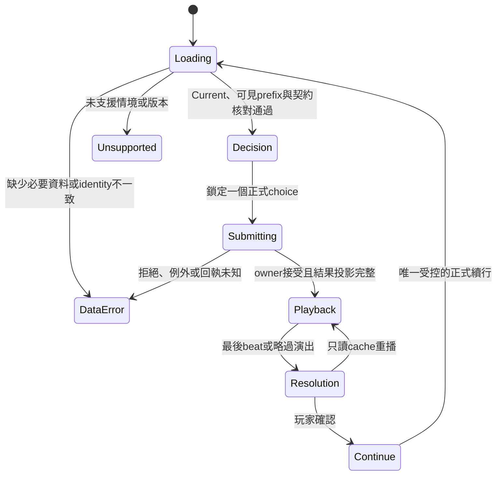

# 《棒球人生》Match UI Slice Data Contract v0.1

Decision / Playback / Resolution — Read-Only Contract Design  
日期：2026-10-16（Asia/Taipei）  
參考 HEAD：`ab3117653945de0b7013636187c446276a96e634`；以現行 WIP 為準。

**本文件是資料消費契約提案，尚無這三種 DTO 的 Production 導出 API。** 唯一受控範例為已驗證的 SS `secureFirstBaseOut`／6-3。正式資料已有事件前後及終場三時點，但逐動作公開投影、提交回執、UI 等待確認及重播契約仍須施工。不能把 diagnostic captures 可讀，視為正式前端已可取得。

本輪只新增本文件與[唯讀查證／靜態驗證 evidence](match-ui-slice-data-contract-v0.1-evidence.json)。未執行新情境、遊戲重播、正式回歸或 browser UI；未修改 Production、既有 tests、fixtures、runner、registry 或 Save schema。

## 1. 目標、範圍與非目標

第一個 PC 可玩切片須讓玩家看懂當前局勢、選擇正式合法守備路線、觀看已完成 execution 的因果演出，再確認本球結果。HTML/CSS 提供資訊與操作，Phaser 未來僅消費演出資料。

本契約保留全部正式 legal choices，不用 UI 自訂答案取代選項。現有受控證據僅涵蓋實際選取的一壘路線；另三個選項的存在不能證明其 execution 成功。其他路線、守位、飛球、短打、reassessment 與不同賽事都不能自動套用本例的七段演出；缺少對應投影時須使用既有正式文字流程或 Unsupported。

不在本輪建立 HTML/CSS、Phaser runtime、Controller、Production Adapter、Receiver v2、Sprint10B、Save migration 或新的 Match Director。未以 UI 改動規則、能力、RNG、球員配置或決策密度。

## 2. 已驗證來源與可採信限制

優先參考：

- [SS Strategic Scenario Fixture & PA Ledger Integration](ss-strategic-scenario-fixture-pa-ledger-integration-v0.1.md)：4 legal／3 strategic meaningful、一次 public decision、6-3 execution、合法進壘、完整同條件 replay。這是受控 fixture，含兩筆明示 setup PA、測試能力與 Physical rolls；不是自然 Production SS proof。
- [Snapshot Integrity Repair](match-moment-snapshot-integrity-repair-v0.1.md)：completedMoment 保存結果當下局勢，終場不得覆寫；打擊的既有 `batterAnticipation.publicContext` 不可冒充 SS Decision Context。
- [Current identity／public resolver](ss-match-identity-public-resolver-contract-v0.1.md)：Current Event owner 決定 Match identity；resolver 不接受任意 matchId。
- [Scoreboard Presentation Integrity](scoreboard-presentation-integrity-sprint-1.md)：可見比分、快照與 feed 受同一 `presentedEventCursor` 限制。其歷史測試數字不算本輪新驗證。
- [Match System](02_Architecture/07_Match-System.md)、[Decision System](02_Architecture/09_Decision-System.md)：設計參考，不替代現行 owner 的實作證據。

在前輪 exact hash manifest、`docs` 直接子項及 `docs/02_Architecture` 的有界檔名盤點中，未找到獨立以 Director／Importance 命名的文件；這不是整個 repository 的不存在證明。現行 `script.js:4325` 有 `getHighSchoolMatchEventPresentationImportance`（hidden／attention／flow），另有 defensive classification／density 與 presentation cursor；不能合稱為已交付的獨立 Match Director API。

Codebase-memory 先取得 index status（generation `2026-10-15T01:30:19Z`），之後 search／trace／snippet／coverage 均回 `Transport closed`。前輪 graph 座標也有 Snapshot 修復前的位置。**本輪沒有成功的最新 graph coverage 結論**；所有實質 owner 證據改用下列明列檔案的現行 source，並保存 SHA-256／函式區段定位。未以 graph 故障推論符號不存在。來源、範例、schema 與驗證明細見 evidence。

Source 文字白名單限：`script.js`、`story.js`、`decision-flow.js`、`match-situation-lifecycle.js`、`match-experience-development.js`、`batted-ball-physical.js`、`defensive-opportunity-foundation.js`、`defensive-reach-secure-foundation.js`、`defensive-decision-throw-foundation.js`、`defensive-runner-throw-settlement-foundation.js`、`match-game-record.js`、`high-school-competition-reassessment.js`，以及 evidence 明列的前置文件／JSON。此清單不授權載入或執行那些程式。1823 檔及前輪 delivery 清單另外只用於 hash 保護，不用作全域 source 搜尋白名單。

## 3. Source／Consumer owner map

以下是現行 JavaScript 真實形狀，不是既有 TypeScript interface。UI 欄為本提案 consumer；「正式 owner」不等於「已有安全 DTO API」。

| 責任 | Actual owner／欄位與型別 | 建立／可讀時點 | 公開／consumer 邊界 |
|---|---|---|---|
| Current Match／Moment | `story.js:1921` `getCurrentEventId`；`script.js:10113` `prepareCurrentHighSchoolYearOneMatch()`；Match `id:string`、`currentMomentId:string`；`:4305` `getHighSchoolYearOneMomentId` | Current Event 準備 Match、producer 建立 Moment；完賽 Moment selector 可回空字串 | Controller 取得同一 Current；不可自行 prepare custom id。prepare 可能建立 state，不是任意 render 都可呼叫的純 getter |
| Decision Context | `script.js:11179` `createGroundBallMatchSituation` → `activeSituation.createdAt:{inning,half,outs,score,bases,paIdentity,simulationPoint}`、`contextSnapshot`；lifecycle `actor:{id,role,position}` | execution 前凍結；`admission.admittedToPlayer=true`、`lifecycleState=presented` 才可選 | HTML 只收局勢與已公開觀察字串。完整 context 含物理／時間資料，不能整包公開 |
| Legal Choice／Commitment | `script.js:7687` `generateInfieldLegalChoices` → `:8830` `getHighSchoolDefensiveMomentChoices` → `:9308` public choice owner；route 為 object array，含 `routeId`、`matchDecision`、`matchMomentId`、`text`、`objective`、`riskProfile`、`route` 等 | producer admission 前建立 legalRoutes，presented 時由正式 choice owner 複製 | HTML 只取白名單欄位；`advisable`、readiness、success hint 不直接公開。上層 public resolver 的一般守備入口實際以 `matchDecision` 查 choice |
| Physical／Opportunity | `BattedBallPhysical.resolveBattedBallPhysicalTruth` (`batted-ball-physical.js:105`) → `groundBallInPlayState.physicalTruth`；truth `ballType/pace/direction:string`、`depth:string|null`、`executionEvidence:object`。`DefensiveOpportunityFoundation.resolveDefensiveOpportunity` (`:133`) 回 `supported:boolean`、`bindingStatus:string`、`primaryPosition/primaryDefenderId:string` | ordinary contact／責任綁定階段，比玩家提交還早 | 原始 truth、binding 為 simulation/internal。Playback 可投影已發生方向／球況；Decision 僅用已公開 presentation cues |
| Reach／Secure | `script.js:4972/4988` → `DefensiveReachSecureFoundation.resolveReach/resolveSecure` (`:53/:91`)；`reachResolution:{reached:boolean,reachQuality:string,margin:number,...}`；Secure `{attemptAvailable,secured:boolean,secureQuality:string,margin?:number,...}` | Reach 在 admission 前可已計算；本例 Secure 在 public execution 建立；未到達時沒有 margin | 計算早不表示可早揭露。Playback 只取 `playerLeg.reach/control` 或對應既存 action 的粗狀態；capabilities／margin／variation 永不傳給 UI |
| Throw／Receiver／Timing | `script.js:11938` `buildHighSchoolShortstopExecution`；handoff `shortstopExecution`、`decisionThrowState`、`runnerThrowTiming`；Throw `{throwAttempted:boolean,throwQuality,releaseQuality:string,receiverId:string|null}`；Timing `{contestAvailable:boolean,timingClassification:string,timingMargin:number|null,runnerArrival/receiverCompletion:object|null}` | 合法 choice 執行後；receiver 由 actual roster 綁定，非畫面挑選 | Phaser 使用實際 action actor／target／粗時序；不公開 arrival 數字，也不能以動畫碰撞判定結果 |
| Resolution Snapshot | `script.js:12280` `applyInfieldResolutionToHighSchoolMatch` → `:10440` `recordHighSchoolYearOneMoment`；`completedMoments:object[]`，有 `id/domain/decision/outcome/consequence/inning/half/outs/scores/runners`；再附 `initialRoute/activeRoute/resultCode/runnerChanges/actionFacts/...` | 正式 settlement 套用後保存；本例 lifecycle 隨後 closed、activeSituation 清空 | HTML Resolution 取這份深複本；Phaser actionFacts 先去除 provenance。不能在 Continue 時重 settle；Moment 本身目前是可變 object，不因 DTO 宣告 readonly 就自動 immutable |
| Game Record／Log | `script.js:4333` `recordHighSchoolMatchSimulationEvent` 建立 `simulationLog`，`sequence:number` 為 push 前 length、附 `presentationSnapshot`；`MatchGameRecord.recordEvent` (`match-game-record.js:312`) 建 `gameRecord.eventRefs:object[]`、inningLines、totals；finalize (`:378`) 寫 `result.finalScore/status/integrity` | 每個 owner event 寫入；完整 Log 可早於畫面，Record active→final | HTML scoreboard 用 `getHighSchoolMatchPresentation().scoreboard` 的可見 prefix；禁止直接用完整 totals／raw feed 揭露未播放事件 |
| Match Final Summary | `script.js:13093` `settleHighSchoolYearOneMatch`：`completed/settled:boolean`、`teamResult/performanceSummary/outcome:string`；Record final | 全場正式完成；gameEnd 也須被 presentation 揭露才展示終場 | 獨立終場／回顧 consumer；不屬本球 Resolution DTO，不填回歷史 Moment |
| Career／Experience | `script.js:12946` → `HighSchoolCompetitionReassessment`：`player.highSchoolCompetitionEvaluation`（sampleCount、appliedMatchIdentities、trendScore 等）；`:13140` → `MatchExperienceDevelopment.settleMatchExperienceDevelopment` (`match-experience-development.js:581`) 寫 `match.matchExperience`（settled、evidenceSummary、aggregated 等） | completed／exposure finalized 後，正式 owner 各自防重複 | 本切片不消費原始評分或成長數值。未來回顧只讀既有公開 settlement presentation；Phaser 不計 Career，也不把一次 play 當全場經驗結算 |

`getHighSchoolMatchPresentation` (`script.js:6274`) 已回 frozen view，含 `matchId`、`scoreboard`、`currentSituation`、`bases`、`feed`、`defensiveObservation`。**不能把整個回傳物件直接當安全 DTO**：`defensiveObservation.ballContext` 複製原 ballContext，本例內含 `physicalTruth.executionEvidence`；`entryHistory` 也未經本契約公開審查。必須逐欄投影、深複製，禁止 object spread 原物件進 DTO。

## 4. Reveal-phase classification

分類針對「某欄位在特定 consumer 的使用」，不是僅看它何時存在於記憶體。同欄位缺乏公開來源或身份核對時，改列 `UNVERIFIED_AVAILABILITY`，不得退回 raw truth 補值。

| 候選資料 | 分類 | 允許來源／限制 |
|---|---|---|
| schemaVersion、matchId、momentId、presentationId、排序鍵 | PUBLIC_AT_DECISION | 前兩個 domain id 由 owner；presentation metadata 是提案新增的記憶體投影，尚無 Production API，不帶 seed 或內部 identity 字串 |
| 當前 inning／half、比分、出局、壘包 occupancy | PUBLIC_AT_DECISION | visible presentation snapshot／scoreboard；與本球 createdAt 核對，cursor 未追到本球就 Loading；不能用 final Match 值補齊 |
| player id／SS、legal route identity、label、戰術目標、已定義粗 risk | PUBLIC_AT_DECISION | 本球 actor／正式 choices；不帶 `advisable` 或事後 decisionQuality |
| 可觀察 direction／pace／runner cue／read cue 字串、情境敘事 | PUBLIC_AT_DECISION | `getHighSchoolDefensiveSituationText` (`:8770`) 及 `defensiveObservation.infield`（`:8584` `adaptInfieldInformation`），presented 時已由正式 presentation 使用。本例有方向與跑者 cue，不需新增 raw physics decision API |
| 完整 `ballContext`／`contextSnapshot` | INTERNAL_ONLY | 內含 physicalTruth、runnerRealization、timingWindows 等；僅取經審查字串，禁止遞迴序列化原 object |
| 已選路線及實際 actor／target | REVEAL_DURING_PLAYBACK | 本球選擇回執及已完成 actionFacts；不展示未選路線的假設 execution |
| 球的粗方向／pace／depth、SS approach／control、throw／receive 狀態 | REVEAL_DURING_PLAYBACK | execution 完成且 identity 一致後，按 beat 白名單釋出；ground depth=null 是有意義的「無此量」，不能補成 medium |
| Timing classification（不含 margin）、最後 Out／Safe／Error | REVEAL_DURING_PLAYBACK | comparison 在接傳之後，result 在末段；結果在 owner 已算出但畫面未到末段時仍不可展示 |
| 本球 completedMoment 的 outs／scores／runners、runnerChanges、outcome、公開文字 feedback | PUBLIC_AFTER_RESOLUTION | 所有結果 beats 結束或使用者選擇略過演出後，一次套用完整結果畫面；不逐 beat 重算比分或進壘 |
| Final Summary、Career public settlement 敘事 | PUBLIC_AFTER_RESOLUTION | 此分類是最早下限；還須「全場 completed 且 gameEnd 已揭露」。不因本球 resolved 就展示終場／成長 |
| 能力、RNG／sample／seed、deterministic rolls、所有 margin／demand／relativeArrival 數字、action.provenance | INTERNAL_ONLY | 包括 actionFacts 裡的 sample、capabilities、timingMargin；即使 execution 後也不納入最小 DTO |
| raw decisionQuality／executionQuality／tier、advisable、evaluation／trendScore／experience weights | INTERNAL_ONLY | 本版只公開既有面向玩家的結果／回饋文字，不導出隱藏判分；合理選擇與成功執行的區分仍保留在正式 owner |
| 精確 XY、速度／秒數、球員跑動曲線、receiver 動作 timestamps、新的安全 beat export、跨重新載入的提交回執 | UNVERIFIED_AVAILABILITY | 原始 coarse timing 不是公尺／秒；現行 capture／observer 也不是 Production export。缺少時用示意演出／正式文字，不能捏造量測 |
| 未選 forceSecond／DP／holdBall 的本球 outcomes | UNVERIFIED_AVAILABILITY | legal choice 存在不提供 counterfactual execution；不得拿來當實際 play |

方向注意：Physical 的 `leftSide` 是粗球場方向，現行 presentation 的「往你的左側」是 owner 字串。本版不將兩者換算為精確世界座標；未來需另定球場參考系。

## 5. 三種只讀 DTO schema（提案）

TypeScript 為文件表示；本輪沒有加入 `.ts` 或修改既有 schema。完整機器可讀形狀及本例實例存於 evidence 的 `proposedJsonSchema`／`examples`。它們不是 Production API。所有 object 嚴格拒絕額外欄位；所有 array 為複本，readonly 須由未來 adapter 深複製並 deep-freeze，不能保留 Match reference。

```ts
type Id = string; // 非空；domain id 必須與同球 owner 一致
type Half = "top" | "bottom"; // 上→top，下→bottom；終不屬 Moment
type Base = "first" | "second" | "third" | "home";
type GameState = Readonly<{
  outs: 0 | 1 | 2 | 3;
  scores: Readonly<{ home: number; away: number }>; // 非負整數
  bases: readonly [boolean, boolean, boolean];
}>;
type Header = Readonly<{
  schemaVersion: "match-ui-slice/0.1";
  presentationId: Id;
  matchId: Id;
  momentId: Id;
  presentationSequence: number; // 本 presentation 內連續非負整數
  inning: number; // 正整數；本例皆為4
  half: Half;
}>;
type PublicChoice = Readonly<{
  routeId: Id;
  matchDecision: Id;
  matchMomentId: Id;
  label: string;
  objectiveText: string;
  risk: "low" | "medium" | "high";
  routeLabel: string;
}>;
type MatchDecisionView = Header & Readonly<{
  kind: "decision";
  player: Readonly<{ id: Id; position: "SS" }>;
  state: GameState; // Decision outs 僅0..2
  situationText: string;
  observations: Readonly<{
    directionText: string | null;
    paceText: string | null;
    runnerCue: string | null;
    readCue: string | null;
  }>;
  choices: readonly PublicChoice[];
}>;
type Beat =
  | { type: "ballInPlay"; payload: { ballType: "groundBall";
      direction: "leftSide" | "middle" | "rightSide";
      pace: "weak" | "moderate" | "firm" | "hard";
      depth: "shallow" | "medium" | "deep" | null } }
  | { type: "approach"; payload: { actorId: Id; status: "completed" | "late" } }
  | { type: "control"; payload: { actorId: Id; status: "completed" | "recovered" | "failed" } }
  | { type: "throw"; payload: { actorId: Id; receiverId: Id | null;
      targetBase: Base; status: "completed" | "failed" | "notAttempted" } }
  | { type: "receive"; payload: { actorId: Id; targetBase: Base;
      status: "completed" | "failed" | "notAttempted" } }
  | { type: "contest"; payload: { runnerId: Id; targetBase: Base;
      comparison: "defenseClearlyAhead" | "runnerClearlyAhead" | "closePlay" | "noContest" } }
  | { type: "result"; payload: { resultCode: "oneOut" | "twoOuts" | "zeroOuts" | "error";
      outsCreated: 0 | 1 | 2; error: boolean } };
type MatchPlaybackEvent = Header & Readonly<{
  kind: "playback";
  eventId: Id;
  actualRouteId: Id;
  dependsOn: readonly Id[];
}> & Readonly<Beat>;
type RunnerChange = Readonly<{
  runnerId: Id;
  from: "batter" | 1 | 2 | 3;
  to: "out" | "home" | 1 | 2 | 3;
}>;
type MatchResolutionView = Header & Readonly<{
  kind: "resolution";
  status: "settled";
  selectedRouteId: Id;
  actualRouteId: Id;
  resultCode: "oneOut" | "twoOuts" | "zeroOuts" | "error";
  batterResult: string; // 本例正式 PA compatibility result="out"
  state: GameState;
  runnerChanges: readonly RunnerChange[];
  outcomeText: string;
  feedbackText: string | null;
}>;
```

### 5.1 Header／共用值的逐欄 mapping

以下每列列出的欄位皆適用該列 null／phase／consumer，沒有隱含可選欄位。

| DTO path | Source owner／mapping | Null／驗證 | Reveal phase | Consumer |
|---|---|---|---|---|
| `schemaVersion` | 提案常數 `match-ui-slice/0.1` | 不可 null；未知版本拒絕 | 隨該 DTO | Controller |
| `presentationId` | 未來 adapter 為「目前 Match instance 的本 Moment」配置 opaque memory token，三 DTO 共用；重播重用原 token，換實例配置新 token | 不可 null；不從 seed／RNG 生成、不寫 Save；尚缺 API | 隨該 DTO | Controller cache／提交鎖 |
| `matchId`／`momentId` | Current `match.id`／正式 Moment id；Resolution `completedMoment.id` 與前者核對 | 不可空；不自行拼固定 Moment2 | 隨該 DTO | 全 consumer |
| `presentationSequence` | adapter 記憶體計數：Decision 0，實際 beats 1..N，Resolution N+1；收到重複包不重新編號 | 非負整數；同 token 唯一且連續 | 隨該 DTO | Controller／Phaser |
| `inning`／`half` | Decision 的可見 currentSituation 與 lifecycle.createdAt 核對；Playback／Resolution 使用同球 completedMoment；half 明確轉 top／bottom | 不可 null；正整數；不接受終 | 隨該 DTO | HTML／Phaser caption |
| `state.outs` | Decision visible outs 與 createdAt.outs；Resolution 只用 completedMoment.outs | 必填；Decision 0..2，Resolution 0..3 | Decision／Resolution | HTML |
| `state.scores.home`／`.away` | Decision scoreboard visibleTotal 與 createdAt.score 核對；Resolution completedMoment.scores | 必填非負整數；明示 home／away，非依畫面左右猜測 | Decision／Resolution | HTML scoreboard |
| `state.bases[0..2]` | Decision visible runners、createdAt.bases 同一 prefix，Boolean occupancy；Resolution completedMoment.runners.map(Boolean) | 恰三個 Boolean；缺 runners 不當空壘 | Decision／Resolution | HTML 壘包 |

### 5.2 Decision 欄位 mapping

| DTO path | Source owner／mapping | Null／驗證 | Reveal phase | Consumer |
|---|---|---|---|---|
| `kind` | 提案常數 decision | 必填 | PUBLIC_AT_DECISION | Controller |
| `player.id`／`.position` | lifecycle.actor.id／position（游擊手→SS），與實際玩家任務核對 | 必填；本切片只支援 player／SS | PUBLIC_AT_DECISION | HTML／Phaser 靜態場景 |
| `situationText` | getHighSchoolDefensiveSituationText 的本球公開文字／lifecycle 已凍結 presentationText | 必填非空；不能用 resolution.outcome 代替 | PUBLIC_AT_DECISION | HTML 敘事／讀屏 |
| `observations.directionText`／`.paceText`／`.runnerCue`／`.readCue` | defensiveObservation.infield 的 direction／pace／runnerCue／readCue，逐個複製字串 | 可 null：沒有正式公開 cue；不補 raw truth；無文字 cue 仍可用合法 situationText | PUBLIC_AT_DECISION | HTML；Phaser 不能從字串推精確座標 |
| `choices` | 正式 choice owner 回傳本 Moment legalRoutes，保留順序及全部合法項目 | 必填非空；id 不得重複、matchDecision 必須唯一可映回；0 choices 為 Unsupported | PUBLIC_AT_DECISION | HTML 原生選項 |
| `choices[].routeId`／`.matchDecision`／`.matchMomentId` | 同名正式欄位，精確字串複製 | 不可 null／空；moment 必須相同 | PUBLIC_AT_DECISION | Controller 提交 |
| `choices[].label` | choice.text | 必填非空；純文字 render | PUBLIC_AT_DECISION | HTML button／radio |
| `choices[].objectiveText` | choice.objective 的已定義本地化對照：secureOut→優先爭取打者出局；attackLeadRunner→優先處理前位跑者；attemptDoublePlay→嘗試完成雙殺；controlBall→控制球與跑者 | 必填；未知 objective 拒絕或走既有文字流程；用「目標」語氣，不承諾結果 | PUBLIC_AT_DECISION | HTML 戰術說明 |
| `choices[].risk`／`.routeLabel` | riskProfile 與 route；本例 controlledHold 顯示「持球」，其他6-3／6-4／6-4-3保留 | 必填；未知 enum 不猜；不帶 availability 時間窗口 | PUBLIC_AT_DECISION | HTML 選項細節 |

### 5.3 Playback 欄位與因果 mapping

| DTO path／type | Source owner／mapping | Null／驗證 | Reveal phase／consumer |
|---|---|---|---|
| `kind`／`eventId` | 常數 playback；adapter 以同 presentationId＋beat 序號配置 eventId | 必填、唯一；重播 id 不變 | 每個 beat 到達時／Controller、Phaser |
| `actualRouteId` | completedMoment.activeRoute；與本球 execution selection、actionFacts 綁定核對 | 不可空；不能填未選 route；本例與 initialRoute 相同 | Playback／Controller、Phaser |
| `dependsOn[]` | 保留正式 action dependency 次序，加入 ball→approach→control 與末段 contest→result 的提案演出依賴 | 必填；首 beat 空陣列；其餘只可引用較早 eventId、不能成環。這不是新 simulation 順序 | Playback／Controller |
| `ballInPlay.payload.ballType/direction/pace/depth` | 同球既有 physicalTruth 的四個公開投影；刪除 executionEvidence、contactQuality 等 | 前三必填 enum；depth 可 null，絕不補預設深度 | 第1段／Phaser |
| `approach.payload.actorId/status` | 本球 actor 與已存 playerLeg.reach（completed／late）；不得重新呼叫 resolveReach | 必填；缺動作可降級正式文字，不能合成成功 | 第2段／Phaser |
| `control.payload.actorId/status` | actionFacts 的 field actor／status，及同球 playerLeg.control；只接受對應 completed／recovered／failed | 必填；兩來源矛盾為 DataError | 第3段／Phaser |
| `throw.payload.actorId/receiverId/targetBase/status` | 已執行 throw action，同球 actionFacts；不從 legal choice 預演結果 | receiverId 可 null 僅限 notAttempted；其他必填。不能為失敗／未嘗試畫成功球路 | 第4段／Phaser |
| `receive.payload.actorId/targetBase/status` | 已執行 receive action；actor 為原接球者，非終場 roster 重新挑選 | 必填；缺 actor 降級；本例為 actual 1B | 第5段／Phaser |
| `contest.payload.runnerId/targetBase/comparison` | stored runnerThrowTiming 的 targetRunnerId／targetBase／timingClassification，或同球 completedMoment.timingResolution.firstLeg | 必填；只有4個 enum；closePlay 不能由 UI 解讀為 Out。noContest 不畫到壘競速 | 第6段／Phaser |
| `result.payload.resultCode/outsCreated/error` | completedMoment 同名正式結果欄位 | 必填；error 是原守備 resolution flag，非 UI 自訂的 official scorer 判定 | 最後一段／Phaser、HTML 讀屏 |

這七種 beat 是本例可支持的粗事件，不是現有動畫 event stream。actionFacts 原生只有 field／throw／receive／baseTouch 四筆；ball、approach、contest 與末段 result 為根據同球已存事實建立的提案分鏡。沒有秒數或 XY。`comparison` 只表示 owner 的粗比較；UI 不用它重算 Out。

### 5.4 Resolution 欄位 mapping

| DTO path | Source owner／mapping | Null／驗證 | Reveal phase | Consumer |
|---|---|---|---|---|
| `kind`／`status` | 常數 resolution／settled；須已確認本球 settlementApplied、正式 completedMoment 與 closed 流程 | 必填；不能只因 resolver 回字串就自行認定所有 identity 通過 | PUBLIC_AFTER_RESOLUTION | Controller |
| `selectedRouteId`／`actualRouteId` | completedMoment.initialRoute／activeRoute，與提交／execution facts 核對 | 必填；如未來 reassess 兩者可不同；本例相同，重決策不在本切片 | PUBLIC_AFTER_RESOLUTION | HTML 選擇回顧 |
| `resultCode` | completedMoment.resultCode | 必填 enum；不由動畫或 tier 推導 | PUBLIC_AFTER_RESOLUTION | HTML |
| `batterResult` | 本球 paCompatibilityResult.result，核對正式 PA event；本例為 out | 必填非空正式代碼；未知 code 走 Unsupported；不能從 oneOut 推定一定是打者出局 | PUBLIC_AFTER_RESOLUTION | HTML 結果敘事 |
| `runnerChanges[].runnerId/from/to` | completedMoment.runnerChanges 同名欄位白名單複製 | 陣列可空但不可缺；from 為 batter／1..3，to 為 out／home／1..3；未知形狀不換算或猜路徑 | PUBLIC_AFTER_RESOLUTION | HTML 進壘摘要／Phaser 靜態終點 |
| `outcomeText` | completedMoment.outcome | 必填非空；可顯示既有原文，不由前端創作新結果 | PUBLIC_AFTER_RESOLUTION | HTML／讀屏 |
| `feedbackText` | completedMoment.causeExplanation；無值時 null | 可 null；不補 raw quality／margin | PUBLIC_AFTER_RESOLUTION | HTML 可展開文字 |

缺失與 unsupported 不塞假值進正常 DTO。三 DTO 之外的 Controller 載入結果須有 `Loading`、`Unsupported(reason)`、`DataError(reason)`；這是提案狀態，不是既有 public resolver response。空陣列、0、false 都只能表示確有此值，不能表示「未知」。

## 6. 最小 UI state machine 與冪等性



1. **Decision**：目前 Match／Moment／Event 一致、玩家是 admitted SS、cursor 可見局勢與 createdAt 相符才啟用選項。`getHighSchoolYearOneMatchMomentChoices()` 對其他域可能 ensure state；UI 應只拿一次經 adapter 準備好的 DTO，不在每次 render 任意呼叫 prepare／choice owners。
2. **Submitting**：先同步鎖住 `(presentationId, matchId, momentId)`，記下完整 choice identity，才呼叫正式 resolver。duplicate click、鍵盤連按、元件 remount 共用同一鎖，不能用 component-local loading 代替命令防重。
3. **公開相容呼叫**：本例 routeId=`secureFirstBaseOut`，實際呼叫 `resolveHighSchoolYearOneMatch("secure", "hs_y1_match_moment_2")`。一般守備 branch 找的是 `matchDecision`，不能把 routeId 當第一參數。Production 保留原 randomSource 預設；capture 的 `.72` 不傳給正式 UI。resolver 回傳結果字串或 false，**尚無 typed receipt**。
4. **接受後**：adapter 必須凍結本球 Decision、beats、Resolution 複本；UI 不取得 raw execution object。結果算完即可等待演出，不能再跑一次 buildShortstopExecution／resolveTiming／settle。原 pipeline 的 execution／validation 重驗是 owner 責任，不是七段演出各呼叫一次。
5. **cursor 邊界**：既有 cursor 以整個可見 event 推進，沒有本例逐動作公開 gate。未來 Controller 必須在提交前 pin Decision 顯示，演出期間禁止另一套舊 renderer／timer 把結果 scoreboard/feed 先畫出；末段後以同球 Resolution 一次更新。不得另寫 Save cursor、讓 Phaser 直接改 presentedEventCursor，或從 raw Match 把終局比分補進來。此橋接尚未實作／驗證。
6. **拒絕／回執未知**：false 可能是 stale phase／錯 Moment／已完成／非法 choice，不能一律當網路失敗自動重送。例外也可能發生在 mutation 之後。保持鎖，經 Current owner 與 completedMoment identity 只讀查證：已有相符結果就恢復 cache；確認未執行且仍是同一 presented Moment 才可回 Decision。無法判定就 DataError，不能重新抽 RNG 試到成功。
7. **Playback／skip／replay**：播放速度、暫停、重播只動記憶體的 presentation cursor。skip 只跳至同一 Resolution，不呼叫 simulation。重播使用原 eventId 與同一 bytes；重播末段回到原 Resolution，不開第二個 Continue handler。
8. **Resolution／Continue**：確認鈕本身只結束本球顯示；Controller 以單一鎖呼叫既有正式續行一次，不能重 resolve／settle。本球結果後才可請求下一個事件。終場有獨立 gate，歷史 Moment 不被改寫。

重整頁面後如何恢復同一 receipt／演出進度，現行 Save 不能由本契約推論已支援。本版不新增 Save 欄位；無可靠 cache 時回到既有正式流程，禁止用重新 simulation 重建動畫。

## 7. HTML/CSS、Phaser 與 Controller 分工

| Owner | 必須負責 | 輸入／邊界 |
|---|---|---|
| HTML/CSS | Scoreboard、局數／出局／壘況、原生決策 controls、文字敘事、詳細資訊、loading／error／unsupported、焦點與讀屏 | Decision／Resolution DTO；比分必須有 home／away 標示。本例0：1是 home0／away1 |
| Phaser | 2D球場、示意球路／人物動作、鏡頭與漫畫式焦點、演出速度／暫停 | 單次釋出的安全 PlaybackEvent；不持有完整 queue 的未揭露 payload、不存 Match reference。不計棒球規則、跑者進壘、Out／Safe／Error 或 Career |
| Match Controller／Adapter（待實作） | Current／Moment 身份核對、嚴格 DTO 投影與 deep-freeze、命令鎖、phase、safe event release、錯誤恢復、只讀 cache／replay、正式 public resolver 與續行銜接 | simulation 與 HTML／Phaser 的唯一橋梁；不安裝 docs observer／physical adapter／fixture builder，不透過它們取得資料 |
| Simulation Authority（既有） | 合法性、responsibility、Reach／Secure、Throw／Receiver／Timing、force／third-out、settlement、Record、Career | 唯一競技事實來源；UI 不能以畫面計時或碰撞覆蓋 owner |

Keyboard／Accessibility 是第一個切片的驗收要求：選項用原生 button 或 radio group，Tab／方向鍵依原生語義操作，Enter／Space 提交；Submitting 使用 disabled／aria-busy，避免焦點無處可去。Resolution 標題取得焦點，結果以 aria-live=polite 宣告一次，重播需由玩家操作後才重讀。提供略過／暫停／重播及 reduced-motion 文字模式；Canvas 不是唯一資訊入口，顏色不作唯一壘況或結果標示。所有文字使用安全 text rendering。

## 8. 唯一 Contract Example：受控 SS 6-3

正式來源是[既有 findings](ss-strategic-scenario-fixture-pa-ledger-integration-v0.1-findings-evidence.json)。本輪由該 JSON 做靜態投影，沒有重跑此場；`presentationId`／beat ids／排序值是提案 metadata，並非舊 capture 已存在的 API。完整三 DTO 範例見 evidence.examples。

| 時點 | 正式事實／DTO 對照 |
|---|---|
| Decision，sequence 0 | Match `hs-y1-autumn-exhibition`；Moment `hs_y1_match_moment_2`；4局上、1out、一壘有人、home0／away1；玩家 SS。公開敘事描述來球進入游擊守區及跑者受迫啟動；不含最終結果 |
| Legal routes | `secureFirstBaseOut/secure/6-3`，目標打者出局；`forceSecond/forceSecond/6-4`，目標前位跑者；`startDoublePlaySecond/challenge/6-4-3`，目標雙殺；`holdBall/contain/controlledHold`，目標持球。全部4項合法，策略 gate meaningful=3 |
| 計數限制 | lifecycle 的 `admission.meaningfulRouteCount=4` 是 unique routes 計數，不能顯示為策略 meaningful=4；holdBall 的 `executionOnly=false` 也不能覆蓋其 `baseballValue=executionOnly` 的 gate 語義。最小 DTO 不輸出 meaningful 計數 |
| 提交 | 公開選擇 `secureFirstBaseOut`，命令參數 `secure`＋正式 Moment id；不是直接低階 apply |
| Playback 1：ballInPlay | groundBall／leftSide／firm／depth=null；不公開 contactQuality、rolls 或 actualPitch |
| Playback 2：approach | 本球 SS 接近；既存 playerLeg.reach=completed |
| Playback 3：control | player 的 field action completed；只此刻揭露控制成功 |
| Playback 4：throw | player（SS）→ first，receiver=`school-development-29d536a2-player-03`；實際路線6-3，throw action completed |
| Playback 5：receive | 同一 actual 1B receive completed；不把二壘傳球／雙殺當成已發生 |
| Playback 6：contest | 打者 `regional-power-school-player-09` 與 first 的比較，`defenseClearlyAhead`；原 capture 的6.4／5／margin1.4只留診斷，不進 DTO、不能稱秒 |
| Playback 7：result | 正式 resultCode=oneOut、outsCreated=1、error=false；末段才揭露打者出局 |
| Resolution，sequence 8 | status=settled；batterResult=out；4上2outs、二壘有人、home0／away1。runnerChanges：player-09 batter→out；原一壘 player-04 1→2。原始 outcome 敘事及簡短 feedback 由 owner 供給 |
| Record 關聯（audit-only） | public call 新增 PA sequence48、meaningfulMomentResolved49、defensiveResolution50，以及一個 completedMoment。不是三次 settlement；Record refs 與 physical／decision identity 需在 adapter 內核對 |
| 後來的真正 Final Summary | 7局終、3outs、空壘、home1／away7，Record final；151筆 Log／unique refs，Experience settled。這些不是本球 Resolution 的補充欄位 |

本球完整 completedMoment 在終場後仍與結果後複本相同。範例以 `home/away` 指定比分，不把「我方：對方」順序泛化到所有 Match。`physicalIdentity`、situationId、decisionIdentity、Record refs 只在來源證據／adapter 內核對，不把它們混成 momentId 或公開 RNG 資料。

## 9. Frontend／Simulation authority boundaries

- UI 只能提交正式 choice 的 `matchDecision`＋expected Moment；不直接呼叫低階 apply、resolveSecure、resolveThrow、resolveTiming、ForceAdvancement 或 Record writer。
- 提交前的 state 源於可見 prefix；提交後的演出源於已完成的同球 execution；本球局勢源於 completedMoment；全場局勢源於 Final Match／Record。四者不可互當 fallback。
- UI 不計出局、不計進壘、不重抽 RNG、不把動畫重播當模擬重跑、不把下一幕確認當重新結算。Phaser 的軌跡、鏡頭和快慢只改演出，不改 owner 事實。
- 原 public duplicate guard、Record event refs guard、settlement guard 各保護自己的層；不推廣成所有低階 helpers 任意重呼都安全，也不代替 Controller 的命令鎖。
- 任何新增 adapter 必須傳遞既有事實；不得用 readonly observer 包裝正式 production owners，或把前輪 test-only injection 接到 browser。

## 10. UI 資料缺口與 Production readiness

| 缺口 | 現況／最小處理 | 本輪判定 |
|---|---|---|
| 三個安全 DTO exporter | 只有既有 presentation／choices 與內部 execution facts；無此版 API | NOT IMPLEMENTED |
| 提交 receipt／同球關聯投影 | resolver 回 string／false；需要 Current、Moment、committed route、completedMoment、Record refs 的 adapter 核對 | 設計明定，尚未 runtime 驗收 |
| 逐 beat reveal 與舊 UI timers／cursor 整合 | 既有 cursor 是 log event 邊界；不能直接提供七個 cinematic beats | 主要施工缺口；無此橋接不能宣稱防洩漏已驗收 |
| 精確幾何／時間 | 現有資料是 coarse zones／relative timing；沒有可用秒數或 XY contract | 先做示意演出／文字；不增加 simulation 模型 |
| 其他 legal routes | 有選項與 public mapping source；本例未執行6-4／DP／holdBall | execution coverage UNVERIFIED；保留正式文字 fallback 或阻止進入此切片 |
| 全場／Career presentation | 正式 final／evaluation／Experience 有各自 owner；原始內部欄位不等於公開前端資料 | 不納入本三 DTO；另案審查公開回顧 |
| refresh／cold reload receipt | 舊證據只保證 memory normalizeSave round-trip 的已驗範圍 | UNVERIFIED；不改 Save、不重演 simulation |

## 11. 最小下一 Sprint 施工規格（待另行授權）

施工範圍先限定 admitted SS ordinary groundBall，保留目前 Current/Event identity 與全部合法選項。第一條完整驗收路線為 secureFirstBaseOut；未支援的 route 演出回到正式文字流程，不能靜默把另一選擇換成一壘出局。

1. 定義正式讀取端／命令回執，按本版白名單導出 Decision、beats、Resolution。先驗 Current／Moment／settlement identity、可見 prefix、choice 映射與缺失狀態，再接畫面。
2. Controller 提供同 Moment 命令鎖、accept／reject／unknown receipt、不可變 cache、playback 順序、skip／replay／Continue；證明 remount／duplicate click／replay／Continue 不新增 PA、Moment、settlement 或 RNG 消耗。
3. HTML 先完成 scoreboard、局勢、選項、敘事、焦點／鍵盤／讀屏及 reduced-motion 文字模式。結果只在指定 phase 出現。
4. Phaser 待資料橋接通過後消費安全 beats；先用粗球場方向與示意時序，不要求新的物理模型；不得直接存取 player／Match globals。
5. 驗收使用明示的同球 input／output 契約，檢查4上1out→4上2outs→7終三時點、raw truth／RNG 無洩漏、replay 只重畫、未知值與 unsupported 可恢復。不同 route 的執行證據另外取得，不能複用本例 PASS。

以上是可施工的提案規格，**不是本輪啟動指令**。不預先擴大到 Receiver v2 或 Sprint10B。

## 12. WIP／protected integrity 與驗證

開工 branch=main，HEAD／main／origin/main tracking ref 均為指定基線；index 無 staged changes。未 fetch 或重新查詢遠端。前輪 baseline 的1823個既有可讀檔案、delivery 的49筆 hash 及 delivery 檔自身均在本輪開工／結案核對；前輪 captures／evidence 不覆寫。結案數值與檢查結果見 evidence.integrity。

Snapshot 四個正式檔案保持原 bytes：`script.js`、`match-experience-development.js`、`tests/helpers/canonical-match-contract-context.cjs`、`tests/canonical-match-regression-integration-test.cjs`。原 WIP（含其他 tracked changes）原樣保留。12個 protected paths 僅使用 baseline 中的 exact path 做 status／size／mtime metadata 核對；未讀、未 hash、未執行或修改其內容。Metadata 相同不是 protected content hash 證明。

**流程偏差如實保留：** 開始讀取附件限制前，已做 repository 全域檔名列舉及未限定路徑的 `git diff --name-only`／`git diff --cached --name-only`。它們只回傳檔名／metadata，未讀 diff 內容，也未讀 protected content。之後停止此做法，source 讀取改用明列 exact paths、Git 只觀測 status／refs／index。不能宣稱本輪從未做全域檔名查找或 unscoped diff 命令。另有只讀工具嘗試因 Python 不在 PATH、Node stdin 編碼／正則錯誤而失敗；未因此執行遊戲或改寫既有資料。

| 設計驗收 | 判定／證據範圍 |
|---|---|
| Schema completeness | PASS（提案）：三 DTO、nested 欄位、enum、nullable、unsupported、來源／consumer 均列明；機器 schema／本例及拒絕案例做靜態驗證，非正式 API 驗收 |
| Source provenance | QUALIFIED：現行白名單 source＋hash、既有同球 findings；graph coverage 連線失敗，不稱最新 graph audit PASS |
| Decision-time visibility | 設計 PASS；現行公開敘事／infield cues 有 source；raw ballContext 明確排除。新 adapter 與 timer 整合尚未 runtime 驗收 |
| Playback ordering | 設計 PASS；本例已存 action 次序及七段映射可查；尚無 Production beat stream／動畫測試 |
| Resolution consistency | PASS（靜態／歷史同球證據）：1out／一壘→2outs／二壘；0：1不被1：7覆蓋；本輪未重跑 Match |
| Public choice compatibility | PASS（source＋既有範例）：routeId 與 matchDecision 分開；正式傳 secure＋expectedMomentId；非 typed receipt 新驗收 |
| Replay without simulation | 規格成立；本輪只檢查範例包不需 simulation。Controller 的不重送／不重 settle 仍待實作驗收；前輪全場 replay 不等於動畫 replay |
| Accessibility／keyboard | 要求完整；尚未建立 UI，沒有實際可用性 PASS |
| Error／unsupported | 缺資料、未知版本、錯 identity、結果未知、未支援情境的規則已定；未做 browser runtime 驗收 |
| Controlled-example sufficiency | YES，僅受控 SS 6-3 契約設計；不是自然 proof、全部 legal routes 執行證明或 Production-ready UI |

本輪只做文件／JSON／局部 source 靜態檢查，未執行舊 capture、fixture builder、observer、adapter、runner、正式 suites 或 browser。沒有 Reset、Clean、Stash、Stage、Commit、Push。

## 13. Commit／Receiver／Sprint gates 與停止

| Gate | 判定 |
|---|---|
| Match UI Slice Data Contract 文件 | COMPLETE（本提案及有限靜態驗證範圍） |
| 三 DTO Production export／Controller／HTML／Phaser | NOT IMPLEMENTED／NOT STARTED |
| UI browser smoke／正式 UI 可玩驗收 | NOT RUN |
| Ready for Commit | **NO** |
| Ready for Sprint10B | **NO** |
| Receiver v2 | **DISABLED** |

完成文件與有限唯讀驗證後停止；後續施工、任何新遊戲情境、Receiver 或 Sprint10B 都不由此文件自動開始。
