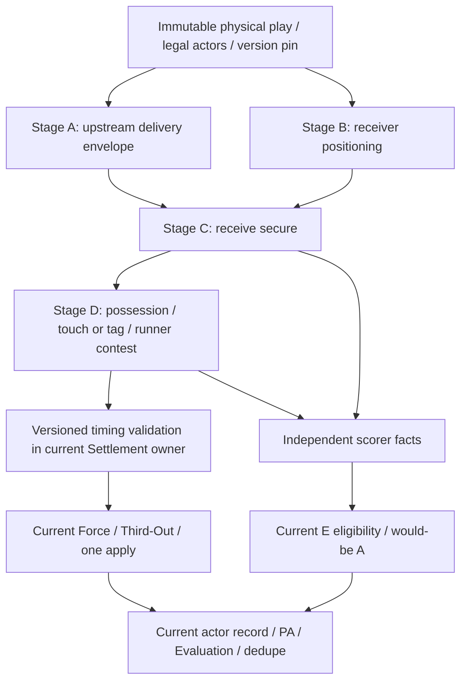

# Receiver Execution v2 — Architecture & Migration Design / Sprint 7

專案：Baseball Life Simulation（棒球人生）
日期：2026-10-12（Asia/Taipei）
正式基線：`37c0735dbe22e101b572f76b1847d47d9adca590`

**設計與隔離比較完成；Implementation Readiness = CONDITIONAL，只適用下一輪經審查的 pure contract 施工。** Receiver v2 未啟用，Production、既有 tests、正式 Save schema 與執行權威均不變。建議先做新 SS primary 空壘的 6-3 direct，再分批處理 direct 與 relay。現有 timing validator、普通努力參考值、能力 adapter 與版本保存仍是接入前置條件。L03 保持 **PARTIAL**，本報告不宣告 Defense Foundation Closeout。

## A. Baseline / WIP

工作目錄為 `E:\meng\baseball_life_sim_semirefactor`。開始與結案均為 main；HEAD／origin/main 同上述基線，index 空。開始只有既有 protected smoke 修改與 11 個未追蹤保留檔，沒有其他未知差異。[Baseline evidence](receiver-execution-v2-sprint-7-baseline-evidence.json)

保護 `tests/fast-check-smoke-test.cjs`、`install.ps1`、Sprint 3 中間 JSON、Sprint 4 四個稽核交付，以及 Sprint 5 五個未提交中間 evidence。沒有讀取、執行、修改或 hash 這 12 個檔案的內容；只以 Git status、檔案存在／大小／mtime metadata 對照保留狀態。因此不宣稱 protected content hash 證明。Sprint 4 的範圍與 finding 參照使用者提供的內容；未開啟受保護的磁碟報告／runner／JSON。

595 個可讀的既有 tracked JS／CJS／JSON／Markdown／index 檔案於本輪前後 SHA-256 相同，排除 protected smoke；三項歷史 Debt tests 亦包含在此對照。新增交付全在 `docs/receiver-execution-v2-*`。沒有 Stage／Commit／Push／Reset／Clean／Stash；本輪不修改任何既有報告或證據。[Final integrity](receiver-execution-v2-sprint-7-final-evidence.json)

Sprint 6 的 52/52 safety、Sprint 5 的 79+33=112/112、代表 13/13 與全量 **224/227 PARTIAL** 是沿用已提交證據，**本輪沒有重跑這些 suites 或原 227 manifest**。三項 Debt 與八項 independent receiver source Red 保持原分類；Prototype checks 不取代 repository regression。

## B. Current Authority & Source Gaps

Discovery 依 codebase-memory Tier 2 的 schema／symbol → 雙向 depth=1 CALLS → snippet → 當前磁碟 source。28 個 traces、16 個完整 snippets、24 條依賴檔案 coverage 查詢均無未取完分頁。16 個 snippet 的內容與當前對應磁碟行完全相同。初次 coverage 全為 `no_recorded_issue`，但 freshness 全為 **metadata_changed**；結案含新增設計檔的 33 paths 亦完整回傳，freshness 為 metadata_changed／not_tracked。兩者都不能當作 freshness 或完整性證明。當前 source 及執行結果優先於 graph。[Architecture / Source Matrix](receiver-execution-v2-sprint-7-architecture-source-matrix.json)，結案 coverage 保存於 final integrity。

Graph 對 namespace API／family registry 的 edge 有缺漏；例如 `resolveIncomingReceive` 的 Production namespace 呼叫與 registry 的 `family.resolve` 以 source 補證。缺少 CALLS edge 不代表不可達。重要 ownership 見 [dispatch](../script.js#L10308)、[infield family](../script.js#L8678)、[1B builder](../script.js#L11555)。沒有從 graph metadata 讀取 protected runner 內容。

A=既有 authoritative 執行事實／owned input；B=從原保存輸入確定推導；C=目前不可得、需要新權威或新輸入。A 的 combined boolean 仍是 combined authority，不能冒充獨立 physical stage。

| Owner／route | 可重用 A／B | C／重要限制 |
|---|---|---|
| SS 6-3、forceSecond、homeForce | canonical Secure／第一傳品質、距離、release、runner arrival；receiver fielding＋sample score | receiverReady threshold 與 atBase=true 不證明獨立到位／hands；起始位置、移動、普通努力缺來源 |
| 2B 4-3、third／home force | 原 control／transfer／delivery、合法 available receiver、`firstLegTimingWindow {value,state}` | `legacyUsableDelivery` 不是 incoming location；ordinal window 不是連續 arrival；ready 與 secured 合併 |
| SS／2B 643／463 | 真實第一 force、pivot actor、receive／turn／secondThrow／firstBaseReceive labels 與舊 threshold | 第二傳獨立 accuracy、到位、hands、continuous arrival 不完整 |
| 2B preventRunHome | catcher／homeTagLeg／原合法 tag slice | failed receive 後的 clean tag completion 不可逆推 |
| player 2B coverSecondFor643 | categorical coverage／upstream quality／receive／pivot 與原 sample | 不是 ordinary-primary admission；canonical physicalIdentity 缺乏，不能以 null identity 開 v2 sampler |
| player 1B incoming | 真實 upstream thrower／canonical delivery、獨立 v1 readinessMargin／handsMargin、arrival | 新位置／移動時間與新版 effort profile 仍需來源；既有獨立 v1 不代表替換後相容 |
| 3B 5-3／543 | canonical acquisition／長第一傳、coarse relay margins | NPC receiver 仍有 fielding proxy；不能因第一傳 canonical 宣稱接球全部獨立 |
| 3U／5U | secured possession＋self touch、live force | 不應新造 Delivery／Receive；沒有 throw margin，不依 arm 成功 |
| Runner Settlement／Force／Third-Out | common runner arrival、live force、ordered retirements、legal scoring、唯一 apply | `deriveSettlement` 嚴格重算 v1 timing；不能偷偷塞 v2 Secure／touch delay |
| Scorer／GameRecord／Evaluation | Sprint 5 E eligibility、would-be A、actual actor ledger、PA H／FC、team E owner、去重 | v2 必須提供有來源 contests；不能從 out／E 反推 stage quality |
| Lifecycle／Save | cache 重建、route-copy、SS execution-copy guard、same-play recovery | 沒有 receiver-v2 version pin；`beginExecution` 會重建 executionState，不能假定新欄位自動保留 |

Source：SS [builder](../script.js#L11859)、2B [receiver](../script.js#L8111)／[initiated route](../script.js#L8129)／[coverage](../script.js#L8300)、[incoming v1](../defensive-decision-throw-foundation.js#L220)、[timing validation](../defensive-runner-throw-settlement-foundation.js#L98)、[lifecycle replacement](../match-situation-lifecycle.js#L114)、[save admission](../save.js#L540)。

## C. Proposed v2 Pipeline

下圖都是 proposed runtime contract；目前沒有接入。建議新的 pure receiver API 置於既有 DefensiveDecisionThrowFoundation，registry／family dispatch 與一次 Match State apply 繼續由原 owner 控制。

Stage A 保存真實 thrower／receiver／target runner／base、accuracy class、quality、delivery availability、ball arrival 與原 action／physical identity。SS／3B canonical 第一傳可重用；2B composite 或舊 relay 不能由 failed／completed label 補造 onTarget／offline。Prototype 的這類 flight／quality 僅是明示 C 假設。

Stage B 保存 receiver 起始 context、守位、required movement、reaction／mobility／range、reachability 與 completion time。Stage C 僅在 delivery 存在且可達、到位時 attempt；輸出 hands margin、secured possession、clean／bobble／failed 品質與 completion。普通努力是額外的 normative projection，不使用弱玩家自身能力當作平均守備者，也不由 sample 成敗決定。

Stage D 需要 secured possession、真實 touch／tag completion、runner arrival 與當下 live force／合法 tag。只產生 candidate contest；Force／Third-Out 繼續決定合法退休及得分。接穩但 runner 已到不等於接球失敗。第一 force 沒完成，不得 pivot／第二傳；第一 force 已是第三出局，也不得繼續。

**四個判定分離**：B 的 reach envelope、B／C 的 execution quality、normative ordinary effort、D 的 legal out。3U／5U 直接從原 acquisition possession 進 self-touch，不建立不存在的接傳。

## D. Stage & Ability Mapping

完整欄位、sample algorithm、illustrative formulas 及能力來源見 [Stage / Sample Contract](receiver-execution-v2-sprint-7-stage-sample-contract.json)。

| 能力 | Proposed stage | 現有實際 adapter／限制 |
|---|---|---|
| Reaction | B 啟動時間 | Career composite；NPC 與 defense 共用，不是獨立觀察值 |
| Range | B 可達 envelope | Career position／fitness composite；NPC defense alias |
| Mobility | B 移動速度 | NPC 原 roster speed 存在，但 speed→movement mapping 需校準；不新增虛構 Career skill |
| Catching／Fielding | C hands／control | ordinary-ground catching 目前 alias fielding；player 1B incoming 有獨立 catching，兩種來源不可混稱 |
| Arm／Throwing | A 第一傳及真實 relay actor 的後續傳球 | 不進 Receiver Secure 或 possession-only 3U／5U |
| Baseball IQ／Decision | pre-execution 合法補位／target intent | fixed explicit legal route 不另抽 IQ safe/out；自然策略另行驗證 |

[Career/NPC adapter](../script.js#L6466) 沒有修改。新版模型能力輸入與實際 Career adapter 是兩份契約；pure input 可分 reaction／range／mobility／catching，不代表現在已有四個獨立 production skills。若允許 legacy aliases，必須保存 adapterVersion／source status，不能寫成新 independent authority。各守位距離與需求不同，不追求同 difficulty 或同成功率。

時間用 CRT（coarse relative arrival）表示與現有 ball／runner race 相同家族的相對時間，起點為同球 upstream launch=0；後段仍使用同一 absolute origin。MDU 為 proposed movement-demand index 0–8：從 atBase、covering、lateCover、distant 起始分類建立需求。**不是公尺或秒**，沒有球場座標時不宣稱測得幾何。

Prototype 的 flight 沿用 `4+distance+quality+release` 形狀，額外 positioning／Secure／touch 係數只是未校準示例。actor duration 不得負；現有 runner arrival 可 ≤0，代表已先到，不能 clamp 或 reroll。CRT／MDU／effort profile 都要獨立 version。新 validator 必須處理 ties、unknown 與 ordered third-out，而不是僅把新 delay 加在 v1 object。

## E. RNG / Determinism

| 方案 | 派生／保存 | 取捨 |
|---|---|---|
| A | 原 owned sample 的 IEEE754 big-endian binary64 hex＋physicalIdentity＋固定 model／sampler／leg／stage namespace，SHA256 派生 vector | 不增 callback；可復原，但 receiver variation 仍受舊 sample 分布影響；不能提早抽 sample 改變 Match RNG 順序 |
| **B（建議）** | physicalIdentity＋固定 namespace 派生 positioning／secure／touch vector；原 sample 仍原樣保存與 binding | 將新 receiver stage 與舊綜合 sample 耦合分開；易作同球能力對照。Hash determinism 不證明統計獨立或自然平衡 |

示例算法：canonical JSON recursively sort object keys，array 順序保留；SHA256 前四 byte unsigned big-endian，`u=(n+0.5)/2^32`。model／sampler algorithm version 固定；release 前另核定跨 runtime numeric precision／quantization，不使用 load-time current defaults。

**sample key 不含 actor、能力、route、stage outcome 或 retry count**。leg 是固定原球 physical action slot，不以成功／失敗或 route 文字重命名。Actor／能力變更不會得到新 vector，但 sealed admission 的 actor／能力 tamper 應拒絕；不是允許換人後沿用舊 actor 結果。原 upstream callback 的 count／order 保留，v2 不讀 Match RNG，不讀 Math.random。

B 可在 admission 由 physical identity 固定 vector；original owned sample 仍於原 execution callback 首次產生，當下完成 execution binding。Pending 不預先補一個 random sample，也不因尚未執行而換方案。相同完整執行輸入保存／JSON cold round-trip 後結果相同。

4096 個**合成 identity** namespace diagnostics：A positioning／secure Pearson=.01709、secure／touch=.00770；B=-.02370／.02332。兩方案可 deterministic repeat，未見此小型診斷的強線性相關；**這不是 independence proof／自然 cohort**。Prototype 的 32 pure capability rows 固定 sample；reaction／mobility completion、range reach、catching／fielding margin 無反向；receiver arm／throwing／decision 不改上述 stage。沒有宣稱全 Career pipeline 梯度或 self-touch v2 runtime 已驗收。

## F. Route Migration Matrix

[完整 15-row matrix](receiver-execution-v2-sprint-7-route-migration-matrix.json) 每列包含 current owner、可重用 stage、candidate stages、新 facts、execution difference、E/A/H/FC、Save versions、historical regression、順序與 first-slice 判斷。

| Route | 保留／新建與可能差異 | 次序／代表回歸 |
|---|---|---|
| **6-3** | 保留 canonical 第一傳；新建 NPC1B positioning／hands／touch timing；late／bobble／hands 可改 race | 2，首 slice；SS／S5／S6／Save |
| 4-3 | 保留 2B control；先取得新 delivery quality／CRT，再建 receiver；ordinal window 不冒充時間 | 3，有 prerequisite；Shared Infield／window／Save |
| 5-3 | 保留長第一傳；NPC receiver proxy 改新 stages，長距離 race 須校準 | 3，6-3 後；3B／muff A/E／Save |
| 6-4-3 | 第一 receive→force→pivot→第二 delivery／receive 分開；concurrent cover／第二 arrival 尚缺 | 4 relay 首項；SS／Force／DP scorer |
| 4-6-3 | 先解 2B delivery，再做 SS pivot／final receive；不換 2B Control | 4，4-3／643 後；2B／DP／Save |
| 5-4-3 | 長第一傳與兩段 receiver／pivot timing；first out／completion wild／muff 分開 | 4，5-3 後；3B／L01-L02／FC |
| 3U | 原 acquisition＋self touch；phase 0 不改，不新建 throw／receive | 保留；1B／arm invariance／Save |
| 5U | 原 third force＋possession touch；不以 receiver model 覆寫 | 保留；3B touch／Force／Third-Out |
| 3-1 | 原 1B acquisition／throw，新增 pitcher cover context／hands／time | 3，NPC direct adapter 後；1B／pitcher／Save |
| 3-6-3 | SS first receive、真實 pivot／return throw、player1B return stages 分開 | 4，return adapter 後；same player A+PO+DP／dedupe |
| SS forceSecond／homeForce | 原 canonical delivery／runner arrival；base-specific receiver stages；target/live force 不改 | 3，home 較後；SS／FC／Third-Out |
| 2B third／homeForce | 原 composite control／window；delivery/continuous time 先決 | 3，4-3 後；2B／FC／force |
| 2B preventRunHome | catcher receive 與 non-force tag completion 分離；missing clean tag 未補造 | 4+獨立 slice；tag timing／Third-Out |
| player2B coverage643 | 原 categorical coverage 保留；新 immutable contact identity 與 upstream facts 為先決 | 延後；coverage／identity／Save |
| player1B incoming | v1 已有獨立 readiness/hands；新版增加 movement/time 仍可能改原結果；incoming DP 再分批 | 3 direct 比較、4 DP；1B／Evaluation／participant Save |

**首 slice 決策**：6-3 限新 SS primary、空壘，initial outs 0／1／2，meaningful／routine 共用 admission owner；合法 direct first-base 或明示 hold/no-delivery branch。真正選擇版本時先看 physical ownership、route surface 與 frozen policy，不能等 onTarget／成功接球後才 opt-in。版本 pin 後，offline／notAttempted 同樣由該版本的 causal bypass 處理。初次 field acquisition failed 的既有 scorer compatibility 不在此 slice 擴張。

Player1B incoming 的優點是 delivery 與獨立 readiness/hands 已存在；成本是更換已 authoritative v1、真實 player catching、firstBasePhase／participant snapshots，且 direct 與 incoming DP 共用接入。因此用作 reference/shadow，暫不作第一個 SS L03 slice。4-3 雖只有一段，卻沒有連續 time／獨立 incoming class，不能當作最小 drop-in。

建議第一輪只有 shadow；待 calibration、timing seam、Save tests 通過才允許一次 apply。Prototype 的 6-3 distance 是 **medium**；clean short scenario 是 SS→2B forceSecond，沒有把同 route 假稱 short。3U／5U、三項 Debt、`.025`／`.99` responsibility lanes 及舊能力公式不屬遷移施工範圍。

## G. Save & Versioning

**Save / Version Compatibility = DESIGNED；v2 runtime Save 沒有實作或執行驗證，不能宣告 PASS。** [Version / Save Contract](receiver-execution-v2-sprint-7-version-save-contract.json)

ground topology 保留三個實際值：`regulation-coarse-zones-v1`、`regulation-coarse-ground-lanes-v2`、`regulation-coarse-ground-lanes-v3`，與 receiverExecutionVersion、timingVersion、adapterVersion、effortProfileVersion、samplerVersion 是不同維度。不能由 topology 或既有 out/E 推斷新版 receiver model。

提案的共同 admission authority 為 `groundBallInPlayState.receiverModelAdmission`，有 lifecycle 時在 contextSnapshot 保存一致副本；routine 不新增虛構 situation。各 family 原 cache 保存 receiver execution output 與 evidence copy。**這些是 draft 欄位位置，正式 schema 未改。** [beginExecution](../match-situation-lifecycle.js#L114) 現行明列欄位會取代 executionState，未來須刻意保留 binding。新版 validation 必須在 [legacy early returns](../script.js#L11990) 之前執行，不能被 firstBase／3B／settlementApplied bypass。

| 狀態 | Proposed 保存／恢復 |
|---|---|
| Legacy pending | recognizable pre-v2 admission 或 explicit legacy tag；保留原 cache/model，缺源保持 insufficiency |
| Legacy executed | 原 authoritative cache＋copy guard；不補新 stages、不抽新 sample |
| Legacy settled | 原 recorded statistics／reference；不 backfill、不再 apply／record |
| v2 pending | admission 已 pin model/algorithm/context；route／actors/caps 在 execution 前 seal；沒有輸出時不能要求已存在的 execution result；原 sample 未產生不預抽 |
| v2 executed | 完整 sealed inputs／sample vector／stage output／timing/copy；只 validation/cache recovery，不 resimulate |
| v2 settled | 完整 version/reference/dedupe；不由 current policy 重算 result 或 record |

識別確定 pre-v2 的 historical omissions 才能 admission 為 legacy；future format 要求 model tag 時，刪除 tag／facts 不能偽裝舊存檔。Unknown model／algorithm/version、矛盾 actor／route／physical／sample／cache copy、非法升降版一律拒絕且不 mutation live player／cursor／record。完整輸出回放及 SHA digest 比對只作 deterministic validation，不是重跑 success roll；digest 不是惡意 edit 的 authentication，仍須 cross-check handoff／roster／source copies。

規劃 **6 個 state rows、54 個 v2 tamper rows、18 個 legacy compatibility/tamper rows**，另包含 cold reload、三次 duplicate submission、meaningful／routine、Math.random 禁用、callback／cursor／outs／bases／runs／PA／Evaluation／record totals。Pending 未配置欄位與 malformed present 欄位分開；historical 真缺 additive copy 仍依舊契約相容。全部標示 **PLANNED_NOT_RUN**；prototype 的 6 個 pure digest tamper probes 不等於 normalizeSave 通過。

## H. Scorer / Evaluation

v2 只供應既有 `resolveScorerEligibility` 所需 facts，沿用 [current eligibility／actor projection](../defensive-decision-throw-foundation.js#L271)、[PA/scorer adapter](../script.js#L11361)、[GameRecord owner](../match-game-record.js#L237)。不建立第二個 E/A 規則系統、PA owner 或 team-E accumulator。Official E/A 不影響動作完成與否。

| 必要 facts | Proposed 來源／缺源處置 |
|---|---|
| Ordinary effort | 凍結 position／league level／field-weather／平均守備 profile；新 reference 未校準則 insufficient，不能以實際低 catching 判平均球員也不會接 |
| Clean reception | 僅更正該 misplay；保留 original actor/route/runner、upstream strength/release、context 與 sample；不造缺少的 throw，不讓快 runner 變慢 |
| Potential out | 同球 clean possession＋touch/tag completion 與 original runner arrival、live force；feasible／alreadySafe／insufficient 明分 |
| Extra advancement | 必須由 movement owner 指向 failedActionId 的因果 deviation／expected destination；初終壘位差不夠；現階段 C，不補造 |
| DP context | leg ID、第一個 actual force retirement、是否可 continuation、第二段真實 throw／receive dependency；pivot 不等於第二 out |

規則 benchmark 為 [MLB 2026 OBR：ordinary effort 定義、9.10(a)(1)、9.12(a)/(d)](https://mktg.mlbstatic.com/mlb/official-information/2026-official-baseball-rules.pdf)。普通努力參考平均同守位／同等級守備者及環境；後續 E 阻止本可成立 out 可保留 preceding A；DP completion wild 的例外與 receiver muff 分開。沒有取得全部臺灣高中賽事特別規程，不能宣稱完成該部分對照。

實際 PO／DP／退休仍只取 actual chain；would-be A 沿用 charged receiver E＋feasible out＋completed upstream throw，與 actual A 同 actor 每球一次。Actual/prevented force 的非安打 FC、already-safe 的 H、extra-advancement E 與原 hit 可共存都由 Sprint 5 owner 決定。Candidate `possiblePA` 僅展示同一分類規則的可能後果，**未呼叫 GameRecord／未記 official PA**。

Evaluation 保存 receiver B/C/D 品質與 actor；接穩但 safe 不降 hands，合法無 E 的 failed hands 仍是 failed execution。Routine incoming 不生成玩家 throwing／decision 證據。Bobble completion 品質應用已有 quality label 投影，而非 completed 一律 strong；同球 evidence 去重維持現行 owner。

**Scorer Integration = PARTIAL**：橋接契約已設計，objective effort calibration、culpable late positioning 的責任 action 與 error-specific advancement 仍缺新來源。Prototype late receiver 回 unavailable／potential insufficiency，不能以此宣稱晚到永遠無 E；也不能把未 attempt 的 positioning failure 改名 hands muff 來補 A。尚未解決的類型須 exclusion／explicit insufficiency，之後各別設計，不能以全域 receiver exemption 過 Gate。

## I. Isolated Counterfactual

[Pure prototype](receiver-execution-v2-isolated-prototype.cjs)、[Final captured evidence](receiver-execution-v2-sprint-7-counterfactual-final-evidence.json)。使用既有合法 fixture 的前段在隔離 VM 產生 legacy witness；不執行原 suites／capture flags、不寫既有 evidence。Candidate 只收 JSON input，不能取得 VM／Match State；輸出留在獨立物件。重用 current pure action／E eligibility／attribution／Force projection，不呼叫 candidate GameRecord、Save 或正式 apply，不寫 Production cache。

每組同 ball／原 runner／真實 thrower-receiver／abilities／owned sample／route-target；新位置、movement、secure/touch demand、effort 都附 **C-proposed** 來源。NPC catching 缺值時的 fielding alias 明列 B compatibility；原 roster speed 只是已知 input，speed→mobility 模型仍為提案。Legacy 缺 quality／distance 的 relay flight 示範 C，不當作還原真實落點。

**12 cases、23 isolation/binding/source-condition checks、32 sensitivity rows** 完成。每組 input 與整個 legacy VM match JSON 前後相同，candidate execution 過程禁止 Math.random，JSON cold round-trip／repeat output 相同。candidate Match RNG callback=0、Production cache／official record write=0；legacy fixture 直接提供一次原 sample，沒有呼叫 public handler，因此本輪不能證明正式 playback callback count 前後相等。以下 out 數都是隔離 initial-outs=0 fixture；v2 欄是未套用的 proposed retirements。

| Case | Legacy outs/E/H | Proposed outs/E/H | 主要 stage／可能差異 |
|---|---:|---:|---|
| clean short SS→2B | 1/0/0 | 1/0/0 | ready＋clean，合法 first force；FC |
| clean 6-3 medium | 1/0/0 | 1/0/0 | SS A、1B PO，無重复 ledger |
| long 5-3 | 1/0/0 | 1/0/0 | long delivery，clean receiver |
| offline SS | 0/1/0 | 0/1/0 | 無 hands attempt；假設普通努力／potential 可證時 thrower E |
| late receiver | 1/0/0 | **0/0/1** | 明示 C distant movement；ready=false，非 hands failure；責任不足，H 只是待審 candidate |
| SS failed hands | 0/0/1 | **0/1/0** | proposed ready＋failedHands；假設平均 profile 允許 receiver E＋SS would-be A |
| fast runner | 0/0/1 | 0/0/1 | 接穩仍 safe，無 E／A／PO |
| ordinary muff 5-3 | 0/1/0 | 0/1/0 | 以假設 effort 判 E，3B A；不造 PO |
| first force／relay delivery fail | 1/0/0 | 1/0/0 | 保留第一 out／FC；第二段無接球 |
| first force failed／no second leg | 0/0/1 | **0/1/0** | no pivot／second attempt；假設 first receiver E 可阻止 force→FC／SS A |
| partial DP final muff | 1/0/0 | 1/0/0 | proposed second clean completion 已晚於 runner；不能自動給 final E／A |
| already-safe muff | 0/0/1 | 0/0/1 | failed hands 仍不給 E／would-be A |

表內 proposed E 依 **未核准 average=10 profile** 得到，只表示可能 scorer interpretation，絕不是 Production stats。另逐組把 effort 改為 insufficient，current scorer 的 conservative interpretation 都不自動授 E／would-be A，actual retirements 不变。既有已可證的 legacy thrower／receiver E 不因此改寫；candidate 從未套回 legacy match。

一組 retirement count 與 H 改變，兩組 hypothetical E/H/assist 改變；標為 **MODEL MIGRATION DIFFERENCE**，不稱 Regression PASS、已合理平衡或 L03修復。Relay 新 CRT 算法讓末端 clean catch 已來不及，顯示 pivot／flight／runner units 需校準，不能藉改 sample／預期或縮短時間湊 second-out witness。

Prototype 僅宣告 admitted force/baseTouch slice 與 original completed pivot ceiling，沒有模擬所有新 relay throw/pivot、同步補位、完整 home tag、third-out、force retreat 或 extra advancement。這些仍由 source matrix／migration prerequisite 明示，不借 pure Force projection 通過宣稱新版整場結算完成。

可重跑 `node docs/receiver-execution-v2-isolated-prototype.cjs`（不寫檔）。`--capture`／`--capture-final` 使用 exclusive-create，既有 evidence 存在時拒絕覆寫。保留[初版 capture](receiver-execution-v2-sprint-7-counterfactual-evidence.json)：其中 `actualLegacyExecutionSampleCallbacks=1` 是誤標，原 fixture 實際直接傳 sample；final capture 已更正為 supplied once／public callback not invoked，結果、23 checks 與32 rows不變。一次 initial source probe 誤讀未存在的 topology 欄位，修正新 prototype 為 current router 的 deterministic topology projection；未改 fixture／Production。一次長 shell argument 失敗後改從新 JSON 讀取 snippets 作磁碟比對。以上均為診斷工具問題，非 repository regression。

## J. Rollout / Rollback

本輪 `runtimeEnabled=false`。未來先 pure contracts，再 read-only shadow，再經獨立批准的小範圍 route cohort；不一次替換 SS／2B／3B／1B。feature policy 用明確 route allowlist 與 model/adapter/effort/timing/sampler versions；只對**尚未 admission 的新機會**選擇版本。Physical responsibility／roster actor 不因 feature flag 改變。

未來 cohort 提案：四守位 × skills 4/10/16 × starter/bench entry × first-legal/預宣告 alternate policy × seeds 88001–88040；**本輪未執行，也非既有自然 career cohort**。施工前再核定 entry/control 合法性與數值 tolerance，不能更換 seeds 湊 failure。每組報合法 admission／exposure、reach/late／clean/bobble/hands／touch/DP、E/A/H/FC、physical sample/cursor、stage Evaluation 與 save reject；零 exposure 明示，未知全場 ground denominator 不補造。

旗標 rollback 只改未 admission 的未來機會。**已 pin model 的 pending，即使尚未 execution，也不換版**；executed 保留原 cache；settled 不重記／回填。部署须保留 pinned versions 的 resolver，不能刪掉 v2後由 legacy fallback。重大 pinned-v2缺陷採 quarantine／人工審查修復，不能覆寫 Save version、reroll 或重判同球。

非法 actor/force/score／重複 apply、reroll/cursor drift、unknown version fallback、舊 save拒絕、無證據 E/A/H suppression 是 stop trigger。分布偏移另外看 preregistered thresholds，不以低 failure frequency 取代規則正確性。

## K. Risk Register

完整 evidence／route／mitigation／validation／blocking 見 [Risk / Sprint Plan](receiver-execution-v2-sprint-7-risk-sprint-plan.json)。Severity 是**未來接入風險優先序**，不是本輪已發現九個 Production defects。

| ID／Severity | 證據與風險 | 防範與待驗證 Gate |
|---|---|---|
| R01 P0 ownership | 新 Secure 與 legacy combined authority 可能同時決定 outcome | 一個版本 owner；no second success／unique action chain；阻擋 activation |
| R02 P1 RNG | 舊共用 sample／decision identity 與新 namespace 可能 drift | frozen physical slots、callback/order equality、reload/retry；阻擋 activation |
| R03 P0 timing | v1 strict validation、2B ordinal、prototype relay already-safe | 新 timing validator／同 origin；ties/unknown/Third-Out；阻擋 integration |
| R04 P1 abilities | catching fielding alias／NPC defense aliases／mobility calibration | versioned real adapter、同 sample sensitivity／self touch arm invariance；阻擋 live slice |
| R05 P0 scorer | ordinary effort C、late position責任 C、extra-base因果 C | objective profile、cause-only clean correction、明示不足；阻擋受影響記錄接入 |
| R06 P0 Save | executionState replacement／legacy early returns | discriminator/pins／54+18 tamper／cold/duplicate；阻擋 live version |
| R07 P0 record | E ownership／PA與defense ledger可能重記／virtual PO | 既有owner、one apply、actor/team/H/FC/count對帳；阻擋 rollout |
| R08 P2 balance | uncalibrated12cases／稀少自然機會／未知ground分母 | shadow／預宣告cohorts／like-stage分母；不阻擋pure design，阻擋平衡與live acceptance |
| R09 P1 old tests | legacy windows/record/cache expectations 仍有權威 | pin舊fixtures；新增version-specific獨立因果驗證；不得改Debt；阻擋新增失敗的merge |

## L. Implementation Sprints

下列為經人工審查後的候選工作，**本輪未開始**。Save／scorer 最小安全驗證要前移至首 slice，不等最後 closeout 才保護存檔。

1. **Contract / Pure Stages**：核定 types／CRT/MDU／effort／adapter／B sampler；pure dependency、fixed-input monotonic 與 noninterference；既有 Runner Settlement 的版本 timing seam先定義。feature off。
2. **6-3 First Slice**：新 SS primary 空壘、一段NPC1B；admission pin／copy guard／cold/duplicate先行；shadow覆蓋offline與no-delivery，核定後才一次apply。不得按throw success挑版本。
3. **Direct Integration**：5-3長距離、SS其他force，再分開3-1/pitcher與player1B incoming比較。4-3先取得自己的delivery/time來源；不全面換2BControl／Throw。
4. **Relay Integration**：先643，再463／543／363；新pivot/transfer／seconddelivery／concurrentcover／arrival，一段failure阻斷後段，each retirement更新force。tag/coverage另有前置slice。
5. **Scorer / Evaluation / Save Closeout**：跨已接通route的ordinary effort／clean／extra advancement、late責任、stage品質、E/A/H/FC去重與完整版本矩陣。未來Production修改後原227一次finalmanifest，三Debt維持。不能以某route PASS推全部L03 PASS。
6. **Controlled Rollout**：獨立授權後從單route cohorts開始，逐批擴張；做pin/history isolation與rollback drill。未有來源的route保持legacy／excluded。

## M. Open Decisions

目前選定 B sample 與6-3 first-slice方向；其餘 D01–D09 明列在 risk-plan，須先審查：

- D01：CRT擴充、version-aware timing入口與relay同步補位時間。
- D02／D03：同league/position/environment的ordinary effort profile；NPC速度／catching alias與實際Career adapter。
- D04／D05：固定sampler算法／physical slot、Save discriminator／欄位位置／resolver保留期限。
- D06：culpable late-positioning如何提供真實失誤責任action，不改名hands取得A。
- D07／D08：2B／relay的真正delivery/time來源，以及error-specific extra advancement因果來源。
- D09：rollout cohorts/tolerances與啟用的獨立人工批准。

CONDITIONAL 表示 pure contract可以進入人工規格審查；**不代表已批准Production接入或模型啟用**。D01–D05阻擋首live slice，D06–D09依route與rollout範圍阻擋擴張。L03、八項source Red與歷史Debt保留，不以新設計欄位冒充已解決來源。

## N. Final Gate

| Gate | 本輪結果 |
|---|---|
| Architecture Source Trace | **PASS**：有界owners／registry／28traces／16current-source snippets／24paths coverage；graph freshness限制明示 |
| Receiver v2 Stage Contract | **DESIGNED**：四stage分權、identity/preconditions／MDU/CRT契約；係數待校準 |
| Sample Determinism | **DESIGNED**：A/B比較、建議B、repeat/cold JSON、actor/skill無reroll；非新版runtimeSavePASS |
| Ability Mapping | **PARTIAL**：purestage邊界已設計，Career/NPC adapter／league calibration待核定 |
| Route Migration | **DESIGNED**：15rows完整欄位／首slice決策／各route缺源前置條件；未接通 |
| Save / Version Compatibility | **DESIGNED**：6state＋54v2／18legacy矩陣；**NOT IMPLEMENTED / NOT TESTED** |
| Scorer Integration | **PARTIAL**：沿用S5owner與contest契約；effort／late责任／extraadvance新來源不足 |
| Counterfactual Isolation | **PASS**：12cases、23checks、32pure sensitivity；candidate不改VM/input/cache/record，callback=0 |
| Rollout / Rollback | **DESIGNED**：new admissions only；pinned pending／executed／settled不換版 |
| Implementation Readiness | **CONDITIONAL**：只供pure-contract人工審查；首live slice尚有blocking decisions |

Production source unchanged、existing tests unchanged、formal Save unchanged、model activation=NO、protected WIP preserved、staging/commit/push=NO、L03=PARTIAL。本輪沒有全量或focusedrepository重跑；既有224/227與新增Production regression=0只作Sprint6沿用基線。此輪自身只提供未修改Production的hash／metadata證據與隔離design checks，不宣稱新版守備regression=PASS。

交付入口：[Baseline](receiver-execution-v2-sprint-7-baseline-evidence.json)、[Architecture](receiver-execution-v2-sprint-7-architecture-source-matrix.json)、[Stage/Sample](receiver-execution-v2-sprint-7-stage-sample-contract.json)、[Migration](receiver-execution-v2-sprint-7-route-migration-matrix.json)、[Save/version](receiver-execution-v2-sprint-7-version-save-contract.json)、[Final counterfactual](receiver-execution-v2-sprint-7-counterfactual-final-evidence.json)、[Risk/Sprints](receiver-execution-v2-sprint-7-risk-sprint-plan.json)、[Final integrity](receiver-execution-v2-sprint-7-final-evidence.json)、[Prototype](receiver-execution-v2-isolated-prototype.cjs)。全部為新增Sprint7檔案，不覆寫其他Sprint原始證據。

完成後停止，等待人工驗收；不開始Receiver v2 Production Implementation或Defensive Foundation Closeout。
