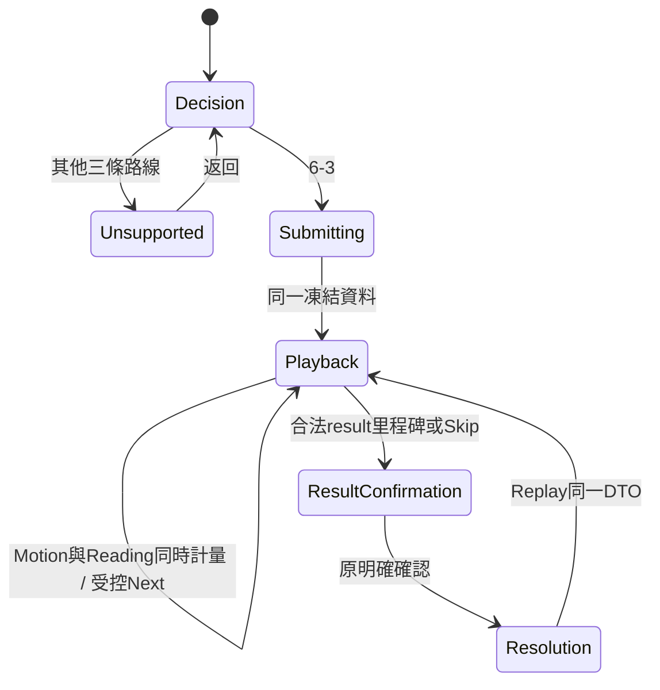

# 《棒球人生》UI-P2.4A — Presentation Clock Contract & Bounded Track Foundation v0.1

日期：2026-10-16（Asia/Taipei）。Branch：main；HEAD：`ab3117653945de0b7013636187c446276a96e634`。

**已建立 opt-in Clock Foundation、Motion／Reading 協調介面、Renderer Ownership handoff 與 bounded track inventory。Legacy 維持預設，未建立可操作新 UI，未啟動 UI-P2.4B。**

修改前基線 **128/128 PASS**。修改後 UI-P2.3 **120/120 PASS**、Manga **7 PASS／1 FAIL**、新增 foundation **15/15 PASS**；合計 **142 PASS／1 FAIL**。唯一失敗是 Manga 原測試固定要求 app.js 保持 UI-P2.3 歷史 hash，與本輪明確授權修改衝突；該測試及歷史 evidence 完全保留，**不是全綠結案**。Browser **NOT RUN**，人工架構審查／動態驗收 **PENDING**。

[Evidence](ui-p2.4a-presentation-clock-track-foundation-v0.1-evidence.json) 保留完整基線與最終測試輸出、來源、manifest、hash 及 WIP 核對。

## 1. 範圍與開工

開工：2026-10-16T13:17:13.272Z。核對目前 branch、HEAD、refs、Git index bytes、完整 status 與 WIP。前輪 manifest 加其報告／evidence，共 **1,926 個既有可讀檔案** hash 相符；12 個 protected paths 的 metadata 相符。保留原 13 tracked、1,188 untracked WIP，沒有 reset／clean／stash／stage／commit／push。

精確修改／新增白名單如下；五個新增目標均在施工前確認不存在：

| 檔案 | 狀態與用途 |
|---|---|
| [app.js](../prototype/match-ui-p1/app.js) | 唯一授權修改的既有檔案：bootstrap／mount、同 Controller 內 clock、renderer handoff |
| [clock-contract.js](../prototype/manga-motion-spike/clock-contract.js) | 新增純函式 contract：來源時間計畫、1× 積分、凍結 snapshot；沒有 timer／Controller |
| [tracks.js](../prototype/manga-motion-spike/tracks.js) | 新增來源 inventory builder、完整性檢查、不可啟用的全程 track gate |
| [foundation.test.cjs](../prototype/manga-motion-spike/tests/foundation.test.cjs) | 新增 15 項隔離測試；fake clock／DOM／RAF，非視覺驗收 |
| 本報告與 evidence | 新增，本輪結果與限制 |

presentation.js、fixture、generated v0.2 asset、正式 v0.2 Contract、舊兩入口與 CSS、所有既有測試、歷史報告／evidence、Production／Save／Match Engine 均未修改。沒有新依賴、Phaser、棒球結果、DTO exporter 或其他路線 Gameplay。

使用 codebase-memory skill 的 Tier 2，精確查 createDemo／mount／project／readingFor。Graph generation 仍為 2026-10-15T01:30:19Z，無匹配節點；24 個既有依據及3個新增 source 路徑皆 not_tracked。以當前 exact source／隔離測試補查，不作索引完整性或無函式的推論，未 reindex。技能檔一般讀取被 sandbox 拒絕，exact-path read-only escalation 成功。

## 2. 修改前問題與相容政策

原 app 使用 animation → readingHold → 下一 beat；getView 在 hold 回傳段末 elapsed，renderer 把每個 WA 設為 duration 後 pause，換 beat 再取消／建立。Manga observer 只更新畫框，不能處理整球 motion cursor。這正是前輪 gate 的限制。

本輪保留舊分支：未提供模式時為 `legacy`；兩個舊 HTML 不新增任何 script／設定，繼續原時間、互動、動畫與 reveal。Legacy view 僅加上 `presentationMode: "legacy"`、`presentationClock: null` 的觀測欄位，未改原欄位意義。原 128 項斷言一字未改；舊位元組 hash guard 的唯一衝突另列第8節。

Continuous 必須明確選擇 `presentationMode: "continuous"`、提供本輪 clock contract，並使用原 v0.2 route／adapter。未知 mode、缺少／不完整 clock contract、使用 v0.1 route 均進 DataError；沒有默默降級。

## 3. Opt-in 接口

既有 `createDemo(fixture, options)` 增加：

```js
{
  presentationMode: "continuous",
  clockContract, // require("./clock-contract.js")，純函式模組
  presentationRoute: { version: adapter.VERSION, adapter }
}
```

`mount(document, fixture, environment, presentationRoute, policy)` 新增可選第五參數：

```js
{
  presentationMode: "continuous",
  clockContract,
  motionProjector // 純函式；本輪沒有實際 SS 6-3 全程 projector
}
```

schedule／cancel／performance 仍從原 environment 進入同一 createDemo。沒有第二個 clock instance 或 Controller implementation。

未來獨立入口若需手動 mount，可在 app.js 載入前宣告 `MATCH_UI_BOOTSTRAP = { autoMount: false }`；原自動 boot 因此不 mount，之後呼叫一次公開 mount 並持有原回傳 handle。也可讓明確 bootstrap policy 由 auto boot 轉交。原入口沒有此設定，所以照舊。這是正式接口，沒有 monkey-patch、source 改寫或偽造 Reduced Motion。

本輪沒有新增 HTML 入口或接線，以上為接口用法，不是 UI-P2.4B 施工。

## 4. Controller-owned Clock state machine

純 contract 不持有時間、不排程、不推進 phase。實際 mutable 的 playTime、readElapsed、anchor、epoch、timer 全在原 createDemo closure 中。render loop 只讀同一 Controller 的 getView。

Continuous 的 `view.presentationClock` 是凍結 snapshot：

| 欄位 | 意義 |
|---|---|
| presentationMode | continuous |
| playbackRunId | 原 playbackRuns；Replay 增加 run，Restart 另以 session／epoch 隔離 |
| epoch | 原 Controller clearTimer／arm 的取消 generation |
| playTime | 同一 Play 的示意演出座標；不是物理毫秒 |
| motionComplete | 已到本輪 bounded clock 的 motionEnd；不代表缺失 track 已核准 |
| paused | 原同一 Controller paused |
| currentSemanticBeat | 只在 Playback 回傳目前已公開的 beat，其餘 null |
| readingState | 目前 stage、已讀 elapsed、剩餘時間；與 motion 分別計量 |
| waitingAtBoundary | Motion 先抵達尚未公開的下一段邊界，正安全等待 |
| resultRevealAllowed | Motion milestone 已達、且 semantic 已進 result 或 Resolution |
| resolutionConfirmed | 只有原 Resolution／Continue phase 為 true |

`playTime = integral playbackRate(activeWallTime) dt` 本輪 rate **固定1×**。contract.integrate 做有限值檢查並限制合法區間；沒有 slow-motion profile／倍率切換 API。讀取 snapshot 不推進狀態，固定 fake wall time 可重複得到相同座標。

語意時間區間直接由原 presentation.durationFor 建立，沒有複製一份新 timing table：

| Semantic beat | Motion 座標範圍 | 閱讀政策／合法推進 |
|---|---|---|
| ballInPlay | 0–450 | 當前公開文字與 motion 同時開始 |
| approach | 450–1550 | 只在當前區間內前進 |
| control | 1550–2400 | 同上 |
| throw | 2400–2850 | 同上 |
| receive | 2850–3450 | 同上 |
| contest | 3450–4550 | 到4550可 motionComplete，尚不一定允許 result |
| result | 靜態節點4550 | 原讀取 hold 及明確確認；舊900ms動作值仍是 legacy來源，不新增假動作 |
| Resolution | 不推進 motion | 原確認後才顯示正式局勢 |

MotionEnd=4550 是前六個**示意演出時長**的和，表示此 foundation 的 bounded cursor 終點。它不是 R1 到壘時間、BR 實際出局時間，也不認證完整 tracks。新尾段若未核准，不能拿 motionComplete 宣稱端到端動態完成。

狀態關係：



## 5. Motion／Reading 分離與安全等待

Continuous 在每個已公開 semantic beat 開始時設 readingHold，**同時**讓合法 motion 前進。它不先跑完 animation 才開始閱讀，不因 stage 名為 readingHold 就把 cursor clamp 成段末。

唯一 Controller timer 排在「當前 motion 區間與 reading 都完成」的時點；兩者取較晚值，而非舊版兩段時長相加。當中：

- Reading 尚在進行，Motion 在目前公開區間仍可前進。
- Motion 先到邊界則停在該合法邊界等待，不採用下一段 payload／結果。
- Reading 先完成，Motion 繼續到目前區間完成。
- requiresConfirmation 仍進原 awaitingConfirmation，由同一 Controller 接受確認。
- 原 readingFor 文字長度、可及性下限、result 必須確認政策繼續使用。

**此 foundation 採保守的 semantic 邊界等待，尚不是全 Play 無停頓實驗。** 本輪解除「每段閱讀必然只在動作完成後開始」的架構限制；跨邊界允許哪些角色繼續、慢動作節奏及長文字的更細政策仍留待下一輪授權。不能把這個接口完成說成實際視覺 continuous track 已完成。

fake clock 測試證據：第一段 stage 已是 readingHold，在200ms時 playTime=200、reading elapsed=200；500ms時 playTime=450、reading elapsed=500，semantic 仍 ballInPlay 並等待；850ms後公開 approach。approach 的閱讀650ms先完成，800ms時 motion仍前進且未換段。這些是 contract／state 行為，非原生動畫測量。

## 6. Renderer ownership 與操作

Legacy 仍使用原 WA 分支。Continuous 在渲染場景時走正式 handoff，**不建立任何 legacy WA**，也不做 legacy animation clamp。

motionProjector 只收到凍結資料：

`{ clock, phase, currentBeat, reducedMotion, textMode }`

沒有 DOM、Controller handle、Decision／Resolution DTO 或未來 beats。回傳僅為四個既有 actor elementId 的 x／y 與 ball x／y；app 先驗證完整性、ID唯一且合法、所有座標有限，再由 app 一次寫入整組 transforms。metadata／身份、比分、占壘、畫框／文字、結果仍由共享 renderer 負責。Projector 是受信任的純函式約定，這不是可執行不受信任程式碼的安全沙箱。

缺少 projector、回傳不完整／非法資料或拋錯，Playback 的 actors／ball／近景會隱藏且 data-track-status=blocked，不借用 legacy movement 假裝已接上完整 track。Decision／Submitting／Unsupported／Resolution 可保留原合法靜態 pose；projector 只在 Playback 被呼叫。

RAF 只要求刷新，**不累加時間**；每次都重新取得同 Controller 的 snapshot。app 持有唯一合法 SVG 寫入權。run／Controller epoch／render generation 三種檢查阻止舊 callback 重寫；Next／Skip／Replay／Restart／mode change 的 render 會取消舊 RAF，pagehide 另清理 RAF、timer、訂閱與 preference listener。沒有 RAF 時仍可在狀態 render 上測試接口，不安裝替代時間 owner。

| 操作 | Continuous 合約 |
|---|---|
| Pause | commit motion與reading座標，取消原 timer；兩者均不補算暫停時間 |
| Resume | 從保存值、以新 anchor 繼續；仍只有一個 timer |
| Next | 明確 seek 到當前合法 semantic 終點，再公開相鄰下一段；整組 sampler 共用同一座標。保留 eventId／150ms guard |
| Skip | 作廢 epoch／動態，seek bounded end，停原 result／awaitingConfirmation；Resolution null，快速Next仍受guard |
| Replay | 清除正式結果、cursor歸零、增加run，重用相同Decision／Resolution及原7 beats；submissionCount不增加 |
| Restart | 重設cursor／閱讀進度、session／epoch隔離舊callback，回Decision |
| Reduced Motion／Text | 原預設暫停；以當前合法靜態終點呈現並保留完整敘事／控制。切換mode會安全暫停，沒有恢復舊WA |

resultRevealAllowed、motionComplete、resolutionConfirmed 分開驗證：contest motion到4550但閱讀未完時，motionComplete=true、resultRevealAllowed=false、Resolution=null；進result後才允許原判決；正式比分／出局／占壘仍等使用者確認。三條 Unsupported 不啟動 Playback、clock保持0、沒有6-3 projector／結果。

## 7. Bounded Track Manifest

tracks.createManifest(fixture, presentation) 是**離線來源盤點**，以未改的 presentation.project 逐段取得原 movement／pose，不複製出另一套坐標表。它會讀歷史 fixture 的 Resolution 做身份／結果擺位盤點，所以其產物帶有未公開資訊標記；**不得把整份 inventory 送進 Decision renderer 或 runtime projector**。現有兩入口沒有載入此模組。

五個角色、35個原 semantic segment 都列出 actor身份、來源file／field、示意起點／終點、Playback interval、normalized [0,1]、originalMovement、newPresentationInterpolation=false、stationaryAllowed、unresolvedGap、availableWhen及involvesUnpublishedInformation。後者保守標記目前beat未公開前不可用；身份可公開階段另列，不把離線bind當作提前公開權。

| Actor | 盤點依據與自然靜止 |
|---|---|
| Ball | ballInPlay、control、throw／receive；原來球／傳球線段保留。無 movement 的 pose 與銜接缺口分開列 |
| SS | player；approach 原示意接近線，控球／傳球可原地，不補造肢體軌跡 |
| 1B | school-development-29d536a2-player-03，取原 receiverId 並與receive actorId核對；throw移向一壘，其後已到位可靜止 |
| R1 | regional-power-school-player-04，取原runnerChanges的from=1；相鄰Playback端點保留，尾段未授權 |
| BR | regional-power-school-player-09，核對contest及batter runnerChange；到壘／退場未定義 |

三個缺口維持明確未授權：

| Gap | 已知示意點 | 狀態 |
|---|---|---|
| A BALL_APPROACH_CONTROL | [137,132]→[128,123] | 無原movement；不新增接球銜接 |
| B R1_RESULT_SECOND | [202,91]→[170,56] | 無連續尾段／公開時點；不宣稱R1全程完成 |
| C BR_ARRIVAL_RETIREMENT | [255,164]→[294,215] | 後點為Resolution擺位；不是到壘／離場track |

validateManifest 檢查版本、路線、角色bind、有限座標及三個未授權gap；移除gap或假設authorized=true均拒絕。assertPlayable 對全程6-3一律以未授權缺口拒絕，其他三路線也拒絕。本輪沒有任何途徑把它批准成完整playable track；下一輪應以新版本和明確授權處理。

座標是SVG示意，normalized時間只用於表現區間。沒有真實跑速、傳球速度、到壘毫秒差或成功率。contest的defenseClearlyAhead仍是分類，不反推出數字。正式DTO／Match Contract不需改動。

## 8. 驗證結果與既有 hash guard

基線：2026-10-16T13:17:13.267Z 至 2026-10-16T13:17:13.491Z，Node v24.19.0，原8 suites **128/128 PASS**。

最終：2026-10-16T13:25:35.648Z 至 2026-10-16T13:25:35.979Z：

```powershell
node --test --test-reporter=tap prototype/match-ui-p1/tests/prototype.test.cjs prototype/match-ui-p1/tests/presentation.test.cjs prototype/match-ui-p1/tests/reading-pace.test.cjs prototype/match-ui-p1/tests/markers.test.cjs prototype/match-ui-p1/tests/fielding-receive.test.cjs prototype/match-ui-p1/tests/spatial-focus.test.cjs prototype/match-ui-p1/tests/decision-consequence.test.cjs prototype/manga-match-spike/tests/manga.test.cjs prototype/manga-motion-spike/tests/foundation.test.cjs
```

| 結果 | 數量 |
|---|---:|
| UI-P2.3 | 120 PASS |
| Manga既有行為測試 | 7 PASS |
| Manga歷史位元組guard | 1 FAIL |
| 新增Foundation | 15 PASS |
| 合計 | 142 PASS／1 FAIL；0 skipped；exit 1 |

**唯一失敗保留：** manga.test.cjs:149 的「original UI-P2.3 entry, shared source, fixtures, contract and evidence remain exact baseline bytes」，在153行固定比對舊evidence的app.js hash。預期 `2e5f09ae4a590aab996f0e8ecba60c5bf2b4fe2f8fe9b9f5ecc97f8dae504246`，本輪為 `ebd38179076b5d1d6d3a52ec8822990467323a6947957216eb142d6a61b7a93e`。這是授權修改的byte差異，並非額外發現的Legacy互動失敗；但測試命令確實失敗，**沒有改測試、放寬assert、改歷史evidence、略過該測試或偽報全通過**。若未來需要全綠，須另行處理這項歷史artifact gate的版本政策，不在本輪越權修改。

新增15項覆蓋本輪全部接口要求：opt-in／未知模式fail-closed、手動bootstrap不重複mount、Motion／Reading／邊界等待、Pause／Resume、Next seek／guard、三種reveal狀態、Skip／Replay資料與取消、RM／Text、Unsupported、單一writer／同時間採樣、Next／Skip／Replay／Restart／pagehide舊RAF、invalid projector、manifest三gap／身份、未授權尾段拒絕、不可改來源hash。測試projector只用同playTime回傳合成pose以驗證接口，**不是新增棒球track或玩法fixture**。

首輪新增測試10 PASS／5 FAIL，原因為測試root路徑層級錯誤；修正新測試路徑後15 PASS。後續補Restart及不完整contract檢查，最終合併執行結果如上。4個JS／CJS的node --check全部PASS。既有測試未變。

沒有Production regression、Match simulation或其他路線Gameplay。既有deterministic asset測試作純離線投影check，未重寫generated asset；本輪共三次修改後合併執行，加一次baseline，計四次該既有檢查，不是新比賽。

**Browser NOT RUN**：本輪無新增可操作UI，依使用者允許不為clock測試強行啟動Browser。沒有Chrome、file://、原生鍵盤、Zoom或視覺連續性通過的主張。人工架構審查PENDING、人工動態驗收PENDING。

## 9. 完整性、未實作與 UI-P2.4B 前提

全manifest結案核對：1,926個既有可讀檔案中僅授權app.js改變，其餘1,925個不變；12個protected只做stat／status metadata，未讀內容／hash／執行。Git HEAD／branch／refs／index bytes及既有WIP status均保留；只加入宣告的五個新檔。最終核對詳見evidence.finalVerification。app.js原本也是untracked WIP的一部分，因此不可只靠git diff宣稱變更範圍；本輪以開工hash manifest作證。

未實作：完整SS6-3 sampler／連續SVG演出、slow-motion曲線及倍率API、新UI／美術、三個缺口插值、物理速度／到壘時間、完整Director、其他路線。沒有修改presentation.js來越過缺口。

UI-P2.4B前提：

1. 人工審查本輪clock與ownership、保守semantic等待和Next seek政策。
2. 明確核准A／B／C的純示意銜接與公開時點；R1／BR端到端track目前仍未完成。
3. 定義可在同一已公開區間內延伸的motion安排與集中rate profile，再以同cursor寫完整projector；不能讓RAF成為第二個clock。
4. 另行授權新入口／視覺連續性與Browser驗收，並處理歷史hash gate版本政策。

本輪完成foundation範圍後停止，不啟動UI-P2.4B／UI-P3／Director／Sprint10B／Receiver v2。等待人工架構審查。

Ready for Commit＝**NO**。  
Ready for Sprint10B＝**NO**。  
Receiver v2＝**DISABLED**。

